双十一那天，博主忽然想起，好久没逛阿里云的域名抢注大厅了。原本只是随便看看，结果刷到一枚正在预订的三字母域名：**`aee.cc`，¥99 起。**

三个字母，后面还是叠起来的 `ee`，连着 `.cc` 一共六个字符。这不比一长串字母更适合当短链入口？再加上博主一直想给主域名 `ybjun.com` 找个小搭档，这个价格确实让人有点心动。

于是，一次“先交押金体验一下”的好奇，变成了五天的围观：让 Codex 手搓监控、接邮件、存快照，和 Gemini 一起拆数据、看出价，直到最后两位买家把比赛拖进加时赛。

先交代结局：**域名没拿下，博主全程没有主动加价。** 但这一趟收获不小——2,181 条监控记录、一套可复用的工具，还有一次比“抢到了”更值得记下来的克制。

## 1 只有一个长期付费域名，为什么还会对 aee.cc 动心？

### 1.1 域名买来得干活，博主不想当“囤米松鼠”

熟悉本站的朋友应该知道，博主对域名一直比较实用主义：**用得上才买，买了就认真用，要买只买com。**

域名圈把买卖域名叫“买米”“卖米”。不过，博主没打算把自己变成囤米松鼠，看到短的、顺眼的就往窝里搬，等年底再发现续费单比项目清单还长。域名每年都要续费，买下那一刻的快乐很短，后面的账单倒是从不缺席。

因此，目前真正列入博主长期付费持有清单的，只有 **`ybjun.com`**。博客、资源站和几项小工具都围绕它展开，一个主域名配合子域名，已经能把许多事情安排得明明白白。为了应对将来可能的涨价，博主还在 **2026 年 10 月底给它续了五年，有效期到了 2032 年**。

这个选择背后有一个很简单的判断：愿意长期投入的，是已经在工作的服务入口。至于“这个名字以后说不定有人高价收”，博主没有靠猜别人喜好赚钱的耐心。

`aee.cc` 动摇的，是“优先买 `.com`”的偏好，实用这条原则倒没有松动。博主想给它安排的岗位很具体：私用短链、高频服务入口、轻量工具，兼顾一个备用域名。真拿下来，交割完成就让它上岗，再考虑长期持有。

### 1.2 双叠字母很好看，二十多年的网页痕迹也很有意思

如果把 `ABB` 限定为首字母与后两位不同，那么三字母纯英文组合只有 $26\times25=650$ 种；再把字母限制在 `a、e、i、o、u` 五个元音里，便是 $5\times4=20$ 种。**这是单一后缀下的字符串组合数**，也是博主觉得 `aee` 顺眼的一点：短、整齐，重复字母好记，输入也顺手。

顺着 Wayback Machine 往前翻，还有点捡到旧物的感觉。博主查到的网页痕迹可以追溯到 **2002 年，距今约 24 年**。早期页面属于委内瑞拉一家应用电气工程公司 **A.E.E. Ingeniería Eléctrica Aplicada C.A.**，后来变成停放、待建设页面，2016 年还有 NameBright 的 Coming Soon 页面。

中途也试过找同类替代品：把 ABB 连同 AAA 一共 676 个组合列出来，用 DNS 查询筛选。脚本一度报出不少“可注册”，拿去注册商逐个核对，却全都已被注册。原因就在判断方法：没有正常解析、查不到 NS 或查询出错，都不能直接推出可注册。所谓“捡漏”提示，得经过真实注册状态核验才算数。绕了一圈，还是回到眼前这枚已经在预释放列表里的 `aee.cc`。

这里顺手校准一个容易说错的细节：**2002 年是已找到的历史网页记录，当时查询的 WHOIS 注册日期则是 2016-10-09。** 两者分别描述网页历史与这一轮注册，不能合成“连续注册了 24 年”。这也让博主打消了给前任持有人编一段传奇身世的念头：看过哪些网页就记哪些，域名为什么转手、公司后来怎样，档案没有交代。

当时做的历史页面与安全平台检查，没有看到灰产、黑链或访问拦截异常。这让它更符合自用需求。老域名如果接手就要忙着处理信誉问题，短几个字母带来的方便，恐怕还不够填坑。

### 1.3 先把 ¥80、¥99 和 ¥300 分清楚

看到 ¥99，不能直接理解成“花 ¥99 就能拿走”。博主这枚标的走的是**万网预释放**，当时页面列出的转入／续费成本为 ¥80，预订时冻结的保证金也是 ¥80。

三笔数字各有用途：

| 项目 | aee.cc 本次金额 | 怎样理解 |
| --- | ---: | --- |
| 预订保证金 | ¥80 | 履约押金，未得标后解冻退回 |
| 起拍价 | ¥99 | 域名竞价的起点 |
| 转入／续费成本 | ¥80 | 得标结算时计入订单 |
| 底价拿下的总成本 | **¥179** | ¥99 + ¥80 |
| 博主接受的最高总成本 | **¥300** | 最高出价 ¥220 + ¥80 |

保证金解冻与订单付款是两条资金流，不能又把它算成第三笔永久支出。阿里云的[交易说明](https://help.aliyun.com/zh/dws/getting-started/domain-name-trading-quick-start)也写明：预订成功后无法取消，得标后要按期限付款，付款成功保证金会自动解冻；得标却弃付，会有保证金被罚没的后果。

最初，博主想的是两百元上下试试看。研究过用途与历史以后，最终给自己留了一点自用溢价：**竞拍价最多 ¥220，叠加 ¥80，总成本封顶 ¥300。** `.cc` 后续年费当时按海外渠道约 ¥58／年的预算估算，这也是拿下之后仍要持续承担的成本，不过博主当时的想法是，拿下先留在阿里云，等一年后快过期了再考虑转出。

喜欢这个名字，可以为喜欢多付一点；但预算要在开拍前定好。否则每次都只差 ¥10，过一会儿就能多出和朋友吃一顿好的的饭钱。

## 2 为了少刷几次网页，让工作站替我站岗

预订截止以后，竞价还有几天。博主还想同时观察其他域名，靠人每隔一阵翻页面，既麻烦，也容易越看越想出手。

于是，熟悉的“自己造轮子”环节来了：把需求交给 Codex，在真实可视浏览器里手动登录，捕获页面本来就在调用的查询请求，再整理成 Python 监控程序。**预订、出价和付款始终由人决定，程序只做查询与提醒。**

经过多次迭代与稳定性打磨，最后留下的能力主要有这些：

- **公开与个人两类数据一起看。** 公开侧用 `snatchSearch.jsonp`、`intrudeDetail` 查状态、价格和计数；个人控制台侧用 `queryAuctionBid.json`、`bidRecords.json` 等接口，查本人已预订竞价域名的领先价、本人价、代理价和逐笔记录。每次都精确匹配完整域名与批次，避免把其他后缀混进来。
- **多个核心标的、多个参考标的分组。** 名单与间隔放在总配置里，修改后下次启动生效。默认 30 分钟一轮，这次后半程实际调到了 15 分钟；累计收录 12 个域名，名单随观察进度增减。
- **一轮只发一封中文增量邮件。** 全部查完再汇总，标出价格 `+¥10`、次数 `+2`、状态变化等。无变化只记日志。本人已预订且处于竞价期的域名，会在同一块邮件里附上明细，手机上也能顺着读。
- **每轮留档。** JSON 快照按日期归档，文件名带微秒时间戳与唯一标识；需要复盘时，再导出 Excel 能直接打开的 UTF-8 BOM CSV。微秒是文件命名精度，实际采样仍按分钟级调度。
- **把可能卡住的工作放进子进程。** 主进程负责调度和心跳，查询、发信各用有硬超时的短生命周期进程；Windows 终端还关闭快速编辑模式，日志走有界队列，减少误点终端或输出阻塞造成的假死。
- **单独盯截止节点与登录状态。** 到期后 8 秒补查相关域名，发现截止时间顺延就跟着改期；鉴权过期则发邮件、弹出一个登录窗口，人工登录并验证成功后继续补抓积压任务。

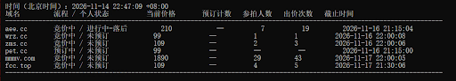

邮件直接接了博主原有的 Cloudflare Workers 发信服务。每次启动先寄一封带生效配置的测试邮件，确认通路畅通，也方便回头查“这一轮到底用什么参数跑的”。Cookie、邮箱凭据这些东西只留在本地，不能跟着日志、快照或文章一起流出去。

节点补抓也有一套去重规则：如果某域名在 $E$ 时刻截止，就安排 $E+8$ 秒的任务；常规定时任务若落在闭区间 $[E,E+90\text{秒}]$ 内，跳过这一轮，保留原有周期节拍。多个域名同时到期合并查，忙于上一轮或正在登录时，恢复后按域名合并补查一次。

实际 CSV 里留下了 **7 轮 `deadline` 任务**，其中 3 轮取得有效新数据，另外 4 轮因账户查询失败没有拿到新值。这个设计确实抓到了 `mzzi.com` 的截止延后，但它仍依赖接口可用。设置了节点任务，也要检查任务拿回来的究竟是不是新数据。

### 2.1 想复刻，可以把这两份文档交给 Agent

由于涉及个人环境配置、会话凭据与内部接口安全，博主暂不直接开放实际运行的源码包下载。不过，已经把功能、模块、只读接口、调度规则与验收要求整理成了独立文档：

- [复刻 Prompt：ybjun-aliyun-domain-monitor-prompt.md](https://wres.ybjun.com/blog222/ybjun-aliyun-domain-monitor-prompt.md)
- [配套 README：ybjun-aliyun-domain-monitor-readme.md](https://wres.ybjun.com/blog222/ybjun-aliyun-domain-monitor-readme.md)

可以把两份文档一起交给 Codex、Cursor 或 Claude Code，让它按自己的环境生成工程，再完成登录与邮件实测。分享版给的是通用 SMTP 配置思路，不需要接博主的私有 Worker。内部接口会变化，Agent 也需要核对实际响应；其中关于预估价涉及汇率的解释，应当作为待核实假设，本文后面的双端观测才是这次真正拿到的证据。

## 3 2,181 条快照里，哪些数字值得相信？

### 3.1 有效记录先筛出来，旧值不能冒充新采样

这份 `snapshot_summary.csv` 覆盖 **2026-11-11 21:29:42 至 11-16 16:31:29**，约 115 小时，共 **324 轮、2,181 条域名记录**。按“当轮数据有效”筛选，留下 **2,132 条，有效率 97.75%**；其余 49 条继续保留，用来定位异常。

这里“轮”与“条”要分开：一轮通常查询多个域名，节点补抓则可能只查一个。324 轮中，常规任务 316 轮、节点任务 7 轮、恢复任务 1 轮。

更容易踩坑的是，查询失败后，表里仍会展示上一次成功快照的价格和状态。这对日常看日志很有用，但整理数据时必须看有效标记与“最近成功采集时间”。否则一串没更新的 ¥210，看起来也能被误当成“每次都验证过还没涨”。

CSV 在结标前就停止了，`aee.cc` 的晚间终局另由现场截图及最终保存的 28 笔完整流水补齐。两部分拼起来，才能讲完这次经历。

### 3.2 bookNum 忽上忽下，像是在给监控出脑筋急转弯

最早的反常现象很直接：`0706.net` 的所谓“预订人数”从 42 掉到 35，`lyj.cc` 从 15 掉到 6，`aee.cc` 又突然跳到 26。

欸，不对啊。预订成功不能随便取消，这种成片回落怎么看都不像交了押金的人数。

先查最常见的程序错误：有没有直接取搜索列表第一项？完整域名是否相同？两套接口是否互相覆盖？确认精确命中同一个 `aee.cc`、同一个批次以后，间隔几秒做了四次采样，`bookNum` 给出的答案是：**7 → 47 → 49 → 18**。其他核心字段并没有跟着变化。

最终的 2,132 条有效记录，也给了很有意思的分布：

| 统计量 | 本次原始 bookNum | 离散均匀分布 $U(1,50)$ |
| --- | ---: | ---: |
| 取值范围 | 1～50 | 1～50 |
| 均值 | 25.78 | 25.50 |
| 标准差 | 14.50（样本） | 14.43（理论） |
| 一阶相关 | -0.0102 | 独立抽样的理论相关为 0 |

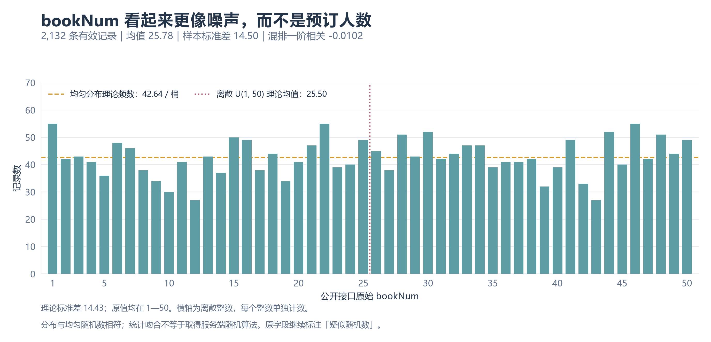

形态与均匀随机数很接近，足以让博主放弃用它预测预订人数。**程序最终保留原值，标注“疑似随机数；口径未证实”，默认不让它单独触发邮件。** 真实竞价人数与出价次数则另取 `auctionNum`、`bidNum`。

统计吻合说明它很像噪声，尚不能证明服务端具体用了哪种随机算法，或为什么这样生成。表中的 -0.0102 也只是按 CSV 原顺序混排计算的相关值，包含相邻不同域名，不能当成单域名时序检验。不过，对实际买家已经够用了：别被这个字段里突然出现的“49”吓得临时改预算。

### 3.3 七人、七次出价，原来还没真正打起来

另一个发现来自 `aee.cc` 开盘：7 位参与者，每个人都在同一秒留下了一条 ¥99 记录。

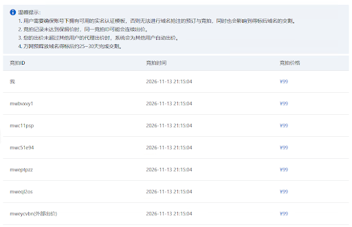

因此，只看“出价次数”会高估热度。博主给参考样本加了一个便于横向观察的指标：

$$
\Delta=\text{出价次数（bidNum）}-\text{参拍人数（auctionNum）}
$$

在每人一条初始化记录的口径下，它表示扣掉入场记录后的额外出价条数。`aee.cc` 中盘是 $19-7=12$，最终是 $28-7=21$；`zms.cc` 是 $3-2=1$；`wrz.cc` 则是 $1-1=0$。

这个“净主动博弈次数”是本文的观测指标，**含代理出价，也不等于真人点击次数**。它最有用的地方，是帮助博主把“几个人来过”与“后来又加了多少价”分开。

### 3.4 大厅里的 ≈ 预估价，真的会比后台低一截

预订过域名后，还有一个能亲眼对照的信息差：手机公开大厅里的 `aee.cc` 标着 **≈¥116**，点进本人竞价页面，却是 **¥129**，下一手要 ¥139。后来又看到一组：后台 **¥210**，公开页面 **≈¥189**。

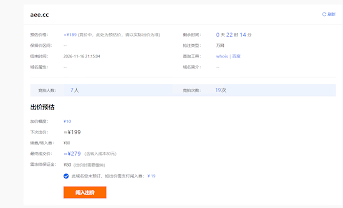

这次只对一枚域名做了有限次双端对照。数值接近九成，但样本不足以确定平台的精确折算公式、触发阈值或价格梯度，更不能由此确定产品设计动机。我们中途讨论过汇率、缓存、折算系数，最终没有拿到足够证据，文章就不替这些猜想盖章了。

参考标的 `mmmv.com` 还给出了一条很有辨识度的锯齿曲线：**¥1,900 → ¥1,890、¥2,800 → ¥2,610、¥3,000 → ¥2,800**。价格回落时，出价次数继续增加。更有意思的是，11 月 16 日 07:02:09 与 13:02:09 两轮，出价次数都为 **55**，公开预估价却从 **¥2,800 回到 ¥2,900**。

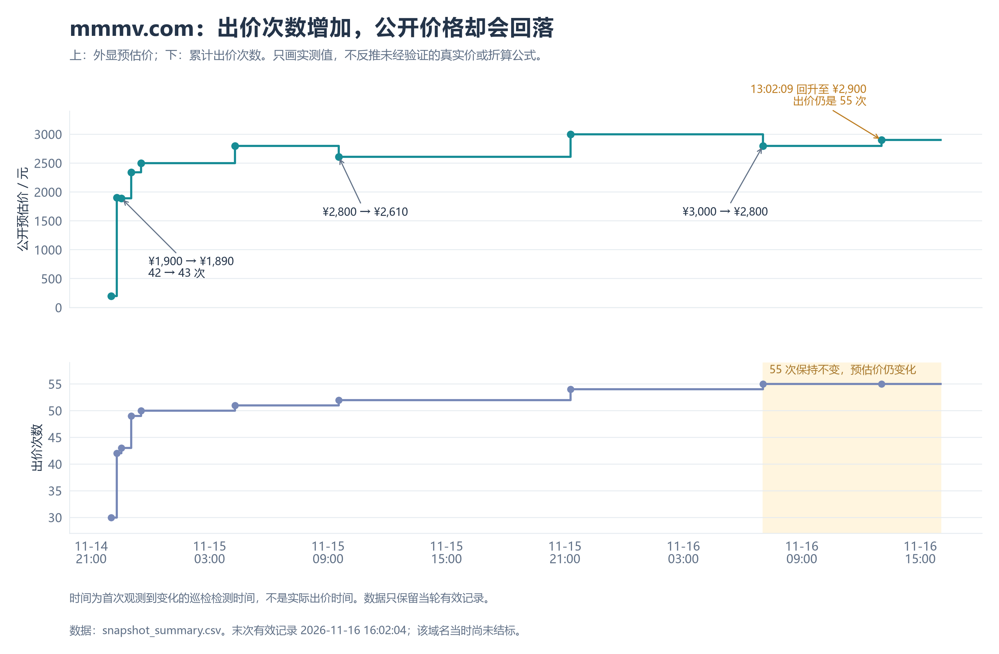

这至少说明：**预估价发生变化，不等于新增一笔实际出价；预估价下降，也不能直接理解为真实领先价下降。** 图里画的只是公开接口实测值，没有用假设公式补出一条“真实价格”。

更实际的问题，是未预订用户想看个究竟，需要先付闯入费。阿里云[闯入竞价说明](https://help.aliyun.com/zh/dws/user-guide/bidding-hall)列出的标准费用为 **¥50／个**，本次现场页面显示的是 **¥19／个促销价**。它按域名收取，**无论得标与否均不退，也不能抵扣保证金或竞价结算款**，并非拿预估价乘某个百分比算出来的。

所以，对路过大厅的买家，博主最想提醒的是：**不要只凭一个偏低的 ≈ 预估价，就冲动支付 ¥19 闯入费。** 进去后的实际最低出价，可能与你刚才心算的完全不同。

### 3.5 “溢价域名”角标，先看续费账单再谈品相

同样 ¥99 起的 `fcc.top`，挂着“溢价域名”，当时查到的续费价却是 **¥1,111／年**。后来大厅里又出现 `312003.xyz`，预订价 **¥29**，一样带这个角标，可是，这不是最便宜的1.111B域名嘛。

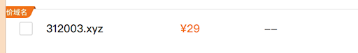

这个标签要结合注册局的定价分类理解。阿里云[价格说明](https://help.aliyun.com/zh/dws/product-overview/domain-name-fees)将精品／溢价域名与注册局定价联系起来；[续费 FAQ](https://help.aliyun.com/zh/dws/support/faq-about-domain-name-renewal)还区分了按普通价格和按溢价续费的情况。买之前应直接看订单里的续费金额，不能把角标当作“好米认证”。

技术上也得分清层次：业务 JSON 中的 `premium` 是平台字段；[EPP 费用扩展 RFC 8748](https://www.rfc-editor.org/rfc/rfc8748.html#section-3.7)使用 `fee:class` 表达费用分类，并没有规定一个所有注册局通用的 `premium=true` 布尔字段。这次没有抓到阿里云与注册局之间的通信，就不把页面标签写成已经验证过的逐层直传关系。

至于 ¥29 为什么也带标签，光看起拍价还解释不完它的成本。对准备长期自用的人，真正该盯的是后续每一年的费用。

## 4 从开盘七个人，到 ¥210 横了两天多

11 月 13 日 21:15，预订截止。四秒后，`aee.cc` 转入竞价，截止时间变成 **11 月 16 日 21:15:04**。页面显示博主以 ¥99 暂时领先，下方却整整齐齐坐着另外六位参与者。

果然不出所料，心动的确实不只我一个。

### 4.1 第一晚到第二天下午，三位对手轮流加价

开盘 16 分钟后，`mwbvxvy1` 在 21:31:09 报出 ¥109。晚上 23 点，`mwc51e94` 报 ¥119，`mwc11psp` 接到 ¥129，随后第一位又跟到 ¥139。

博主继续没动。一方面距离结束还早，另一方面，自己并没有一定要拿下的刚需，让其他人先出价，也能看清这个域名到底有多少竞争。

第二天早上出现了最直观的一次代理出价：08:46:49，有人报 **¥149**，系统同秒替 `mwbvxvy1` 报 **¥150**；十秒后，挑战者再到 **¥160**。下午又出现一组 **¥190 → ¥200（代理）→ ¥210**。

这两条带标记的代理记录，比“这个人可能是机器人”之类的猜测有用得多：至少我们知道平台确实替他自动跟过价。不过，对手后来还会不会调整上限，旧记录本身回答不了。

到 **11 月 14 日 14:22:38**，`mwc11psp` 用 ¥210 领先。博主看到的下次最低出价，已经是 **¥220，含转入成本总价 ¥300**，恰好踩着自己的天花板。

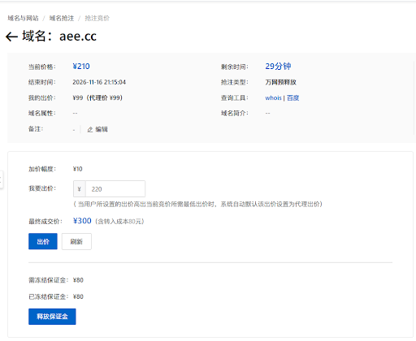

### 4.2 越是没有变化，越容易脑补“最后捡一手”

接下来，盘面竟然真就不动了。从 ¥210 那条记录，到 16 日晚上下一笔 ¥220，间隔 **54 小时 43 分 49 秒**。

看邮件、看快照，还是 7 人、19 条、¥210。最初的“有这么多人，估计拿不到了”，慢慢变成“是不是大家的预算也就到这里？”要是临近结标点一次 ¥220，没人再跟，或许就能拿走。

博主甚至把计划细化到了 **21:09:30～21:09:50**：仅当领先价仍是 ¥210 时提交一次 ¥220，被反超就结束，绝不第二次加价。按照当时页面时间，闯入通道在 21:05:04 关闭，最后五分钟延时窗口从 21:10:04 开始，计划落在两者之间。

回头看，这段等待比价格上升还磨人。价格涨得快，放弃很容易；价格横在那里，反而会不断给自己留希望。连“也许还能拿它做这个、再挂那个服务”的用途清单都能越想越长。

好在，预算在前面已经定下来了。它能接哪些服务，之前就考虑过；其他人愿意多少钱买，也不会自动增加博主对它的使用需求。

### 4.3 收官前，登录能恢复，滑块却没有那么听话

监控也在最后一天给博主补了一堂课。此前，从 13 日晚的新登录态到 15 日 21:45:54 的 `auth_expired`，运行跨度约 **47 小时 42 分钟**。登录窗口与提醒机制起了作用，人工重新登录后，16 日上午还能继续采集。

但到下午，程序报“接口返回格式变化”，浏览器又弹出滑块，反复出现 **`error:Vn7rg`**。这时，账户控制台仍能用，公开大厅却访问不顺畅。登录成功与公开搜索请求被允许，显然是两件事。

按重登后的 CSV 切片计，连续 **70 轮、420 条域名查询记录**里，前 419 条成功，第 420 条对应的 `fcc.top` 首先失败，之后的轮次全线异常。这里数的是域名查询记录，**不是完整网络抓包中的 HTTP 请求总数**；加上详情、鉴权、重试等请求，实际网络访问还会更多。

所以，这次观察不能提炼出“420 次必封”或“48 小时必掉”的平台固定阈值。它真正改变了博主的做法：停止脚本，也停止在同一个抓包窗口里反复折腾验证。最后几小时直接用日常浏览器、手机流量看本人竞价页面，不再临时加快扫描频率。

还有一个与调度有关的细节：8 个进入过竞价期的样本，新截止时间相对原预订截止时间，都是 **72 小时再多 3～8 秒**。

| 多出的秒数 | 域名 |
| --- | --- |
| +3 秒 | 0706.net |
| +4 秒 | mzzi.com、aee.cc |
| +5 秒 | 21435.com、mmmv.com |
| +6 秒 | fcc.top、zms.cc |
| +8 秒 | wrz.cc |

它支持我们别在整点归零那一瞬间就急着判定结果，也解释了为什么给补抓留一点缓冲。但这些秒数仍只是截止字段的偏移，尚不能据此确定平台后台队列如何运作。**监控负责提供信息，关键时刻保留一条可正常操作的人工通道，更踏实。**

## 5 21:06:27，有人替我取消了出价计划

### 5.1 潜伏者先报 ¥220，博主切回观众席

16 日 20:59，博主还在纠结：“怎么又开始纠结要不要出一次价了哈哈哈哈哈哈。”明明计划好了，真到要点按钮的时候，还是会重新掂量这 ¥300 值不值。

没想到，还没等到预定的 21:09，局面先变了。

**21:06:27，`mweql2os` 报 ¥220。** 这个开盘以后一直没有加价的参与者，忽然在最后几分钟出现。下一手已经变成 ¥230，算上 ¥80，总成本 **¥310**。

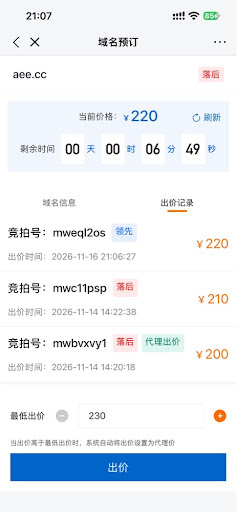

触发条件很简单：不再是我能接受的那一手，取消计划，继续看戏。

但手还是痒过。21:12，博主又在打鼓：“有没有必要再跟一手探一探这个人？”好像只要把加价包装成“验证对手”，就能显得更像技术研究。

算一下就清醒了：**这一手提交出去，是要准备按 ¥310 买下的。** 对手有没有代理价、会不会再跟，都不能替我承担这张订单。于是，按钮最终没有点，博主拿着手机流量，安心转成吃瓜群众。

### 5.2 外部出价把比赛拖进加时，最后五分钟一遍遍重来

原定 21:15:04 结束，21:13:22，`mweycvbn(外部出价)` 突然报出 **¥230**。25 秒后，`mweql2os` 回到 **¥240**，加时赛开始。

这个“外部出价”是平台展示的渠道标记，无法由此判断买家的国籍或所在地。前面聊天里我们给对手猜过不少身份，终局流水真正能告诉我们的，还是时间、价格和出价记录。

21:16:15，外部参与者出 ¥250；**五秒后**，另一位回 ¥260。随后安静了 **3 分 22 秒**，21:19:42 再到 ¥270，**四秒后**又被 ¥280 超过，21:20:08 外部出价来到 ¥290。

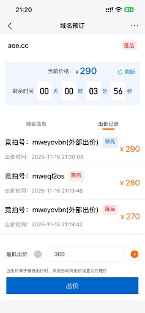

看着几秒、几十秒、三分钟交替出现，博主当时甚至忍不住吐槽，是不是“不蒸馒头争口气”。但我们坐在屏幕外，看不见他们各自的用途和预算。这一段记录没有标出代理出价，节奏很像你来我往地手动跟进；至于背后究竟怎样操作，留在观测范围内就好。

**21:21:34，`mweql2os` 报出 ¥300。** 之后没有新报价，最终结束时间停在 **21:26:34**，正好是最后一笔出价再加五分钟。相对最初的 21:15:04，累计延后 **11 分 30 秒**。

这个结果还纠正了最初“每次都在原截止上加五分钟”的想当然。本场末段实际留下的，是新报价之后重新等待五分钟的轨迹。阿里云[竞拍规则](https://help.aliyun.com/zh/dws/user-guide/booking-and-bidding)提醒最后五分钟新出价会触发延长，实操时必须盯着页面更新后的截止时间，卡最后一秒并不能保证结束。

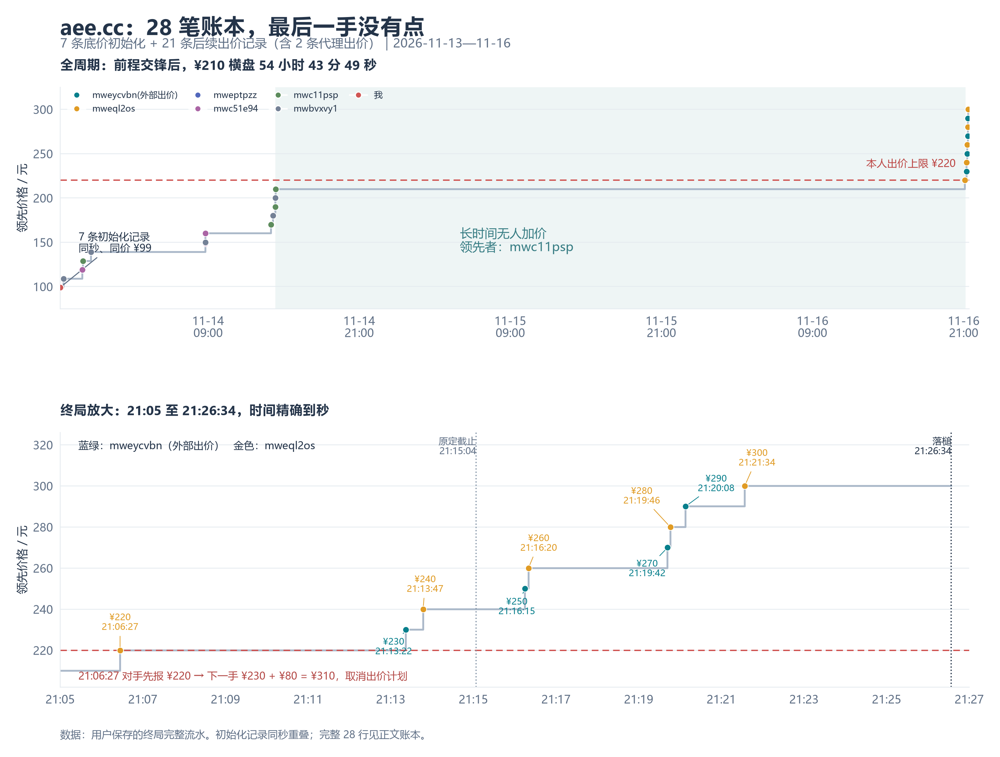

成交价 **¥300**，叠加这枚域名页面列出的 ¥80 转入／续费，订单口径的总成本为 **¥380**，是底价总成本 ¥179 的 **2.12 倍**。博主的 **¥300 总预算**是连续费一起算的上限，而现在，明显已经“遥遥领先”。

### 5.3 完整 28 笔账本，留给以后慢慢对照

下面按时间正序整理。七条初始化同秒同价，行序沿用终局列表反向整理的顺序，不据此重新推断预订先后。后续 21 条中，有两条明确标为代理出价，因此不能全叫“21 次手动点击”。

| 序号 | 时间（2026 年，北京时间） | 竞拍 ID | 价格 | 记录类型 |
| ---: | --- | --- | ---: | --- |
| 1 | 11-13 21:15:04 | mweycvbn（外部出价） | ¥99 | 初始化 |
| 2 | 11-13 21:15:04 | mweql2os | ¥99 | 初始化 |
| 3 | 11-13 21:15:04 | mweptpzz | ¥99 | 初始化 |
| 4 | 11-13 21:15:04 | mwc51e94 | ¥99 | 初始化 |
| 5 | 11-13 21:15:04 | mwc11psp | ¥99 | 初始化 |
| 6 | 11-13 21:15:04 | mwbvxvy1 | ¥99 | 初始化 |
| 7 | 11-13 21:15:04 | 我 | ¥99 | 初始化 |
| 8 | 11-13 21:31:09 | mwbvxvy1 | ¥109 | 出价 |
| 9 | 11-13 23:00:13 | mwc51e94 | ¥119 | 出价 |
| 10 | 11-13 23:03:42 | mwc11psp | ¥129 | 出价 |
| 11 | 11-13 23:42:33 | mwbvxvy1 | ¥139 | 出价 |
| 12 | 11-14 08:46:49 | mwc51e94 | ¥149 | 出价 |
| 13 | 11-14 08:46:49 | mwbvxvy1 | ¥150 | 代理出价 |
| 14 | 11-14 08:46:59 | mwc51e94 | ¥160 | 出价 |
| 15 | 11-14 14:00:01 | mwc11psp | ¥170 | 出价 |
| 16 | 11-14 14:09:36 | mwbvxvy1 | ¥180 | 出价 |
| 17 | 11-14 14:20:18 | mwc11psp | ¥190 | 出价 |
| 18 | 11-14 14:20:18 | mwbvxvy1 | ¥200 | 代理出价 |
| 19 | 11-14 14:22:38 | mwc11psp | ¥210 | 出价 |
| 20 | 11-16 21:06:27 | mweql2os | ¥220 | 出价 |
| 21 | 11-16 21:13:22 | mweycvbn（外部出价） | ¥230 | 出价 |
| 22 | 11-16 21:13:47 | mweql2os | ¥240 | 出价 |
| 23 | 11-16 21:16:15 | mweycvbn（外部出价） | ¥250 | 出价 |
| 24 | 11-16 21:16:20 | mweql2os | ¥260 | 出价 |
| 25 | 11-16 21:19:42 | mweycvbn（外部出价） | ¥270 | 出价 |
| 26 | 11-16 21:19:46 | mweql2os | ¥280 | 出价 |
| 27 | 11-16 21:20:08 | mweycvbn（外部出价） | ¥290 | 出价 |
| 28 | 11-16 21:21:34 | mweql2os | ¥300 | 出价 |

前程最活跃的三位，最后分别停在 ¥200、¥210 和 ¥160；真正收官的两位，之前都没有参与那轮中盘拉锯。博主与 `mweptpzz` 则始终只有初始化记录。**横盘很久，不代表其他参与者已经离开；看见旧代理价被突破，也不能读出一个人此后的全部预算。**

## 6 热门盘很热，冷门盘也确实有机会

这次累计观察的 11 个参考域名是：`0706.net`、`21435.com`、`mzzi.com`、`lyj.cc`、`wfi.cc`、`vbf.cc`、`wrz.cc`、`zms.cc`、`pet.cc`、`mmmv.com`、`fcc.top`。

把进入过竞价期的 8 个域名放在一起，冷热反差相当直观。下表中，**只有 `aee.cc` 用终局完整流水，其余使用各自最后一条有效 CSV 记录，价格为公开预估价**。

| 域名 | 人数／记录数 | 净博弈 Δ | 价格 | 数据落点 |
| --- | ---: | ---: | ---: | --- |
| mzzi.com | 25／84 | 59 | ≈¥3,188 | 11-14 21:15:32，仍有延期 |
| mmmv.com | 29／55 | 26 | ≈¥2,900 | 11-16 16:02:04，未结标 |
| **aee.cc** | **7／28** | **21** | **¥300** | **11-16 21:26:34 终局** |
| fcc.top | 4／6 | 2 | ≈¥119 | 11-16 15:47:20，未结标 |
| zms.cc | 2／3 | 1 | ≈¥109 | 11-16 16:02:04，未结标 |
| 0706.net | 2／2 | 0 | ≈¥99 | 11-14 21:37:39，结标前 |
| wrz.cc | 1／1 | 0 | ≈¥99 | 11-16 16:02:04，未结标 |
| 21435.com | 1／1 | 0 | ≈¥199 | 11-12 23:57:35，提前结束跟踪 |

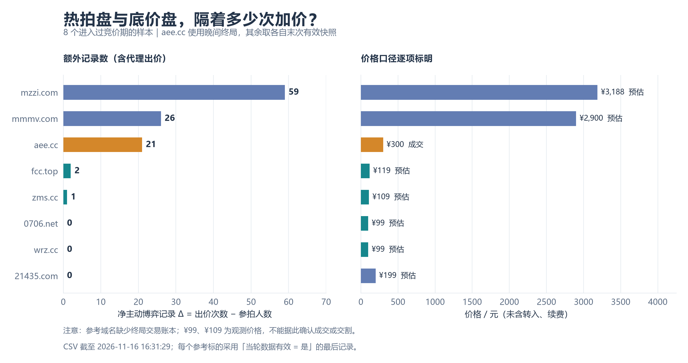

`mzzi.com` 在第一份快照里就已经是 22 人、63 条、≈¥909，后来达到 84 条；`mmmv.com` 也很快冲到四位数。另一些标的却安静得多：`0706.net` 观测期里始终是两人两条、¥99，`wrz.cc` 一人一条、¥99，`zms.cc` 只多了一条记录，停在 ¥109。

这足以让博主相信，预释放大厅确实值得偶尔逛逛。有人扎堆的名字很快就涨起来，适合个人项目、又没碰上竞争的名字，则可能在很低的价格区间停留许久。**能不能捡漏，要看具体域名与自己的用途，不能只按后缀给整盘估价。**

`lyj.cc`、`wfi.cc`、`vbf.cc` 还有一个必须记下的反转：预订结束后，它们从搜索结果里消失，我们当时一度猜测是单人得标；**13 日晚，博主又亲眼看到它们进入清仓拍，直到本文写完，还在贴着9元地板价挂着**。

清仓拍因此也值得看。官方说明，它针对预释放阶段无人预订的域名，展示期三天，价格逐日递减、先到先得，且列表更新会晚于预订结束。博主当时翻过一千六百多个 `.com`、`.net`、`.cc` 结果，¥9、¥19 的名字不少，有很长的杂合词，也有看起来曾认真建过站的老拼音。

但“便宜”和“适合我”之间，还得过几道检查：

1. **先想好用途。** 项目叫什么、入口怎样记、后缀是否合适，先有需求再选名字，避免买完以后给它临时安排工作。
2. **按完整账单比价。** 起拍／清仓购买价之外，还有转入、续费；带溢价标签的尤其要点开看。¥9 的入口价，也不等于下一年只续 ¥9。
3. **查历史与实际访问。** 看网页存档、搜索记录及安全平台提示，检查是否存在拦截或明显污染；也别把某次没查到异常写成永远没有历史问题。
4. **先定总预算，再打开出价框。** 把固定成本一起算进去，当前最低出价超过上限就停止。对方出到哪里，留给对方自己的需求决定。
5. **留出交割时间。** 预释放得标以后还有付款和交割过程，原持有人赎回等情况也会影响结果。计划马上上线的服务，应先准备可用入口。

至于看起来很诱人的 `pet.cc`，这份 CSV 截止时它还在预订中。它后来究竟有多热，留待新的完整数据再说；这次没有为了围观而额外交押金。

现在回头看，博主没有拿下 `aee.cc`，也没什么遗憾。**¥80 保证金无损退回，¥300 总预算守住了，监控工具和这一整份记录留了下来。** 其中有自动化确实省下来的时间，也有脚本没能接住的异常，还有我们被新证据纠正的判断。

更有意思的是，盯了五天，最后最值得记住的动作，竟然是没有点下那一次“出价”。

这以后，博主还是会把阿里云抢注大厅当成闲鱼，不定期进去逛一圈。以后如果又遇见一枚合眼缘、用得上、价格也合适的域名，咱们再继续折腾。至于眼下，先让 `ybjun.com` 好好干活，文章、照片和小工具还等着它呢。
