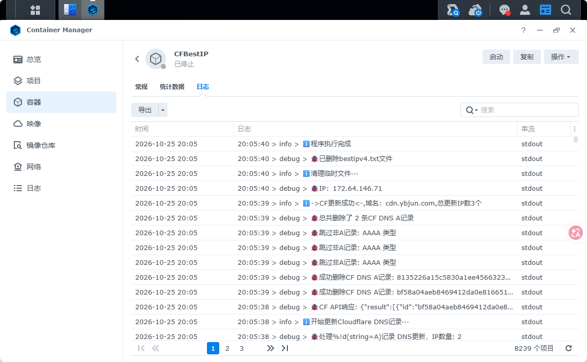
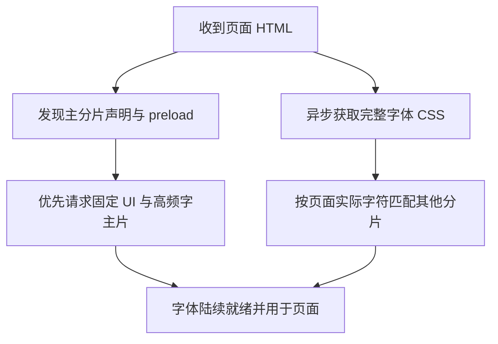
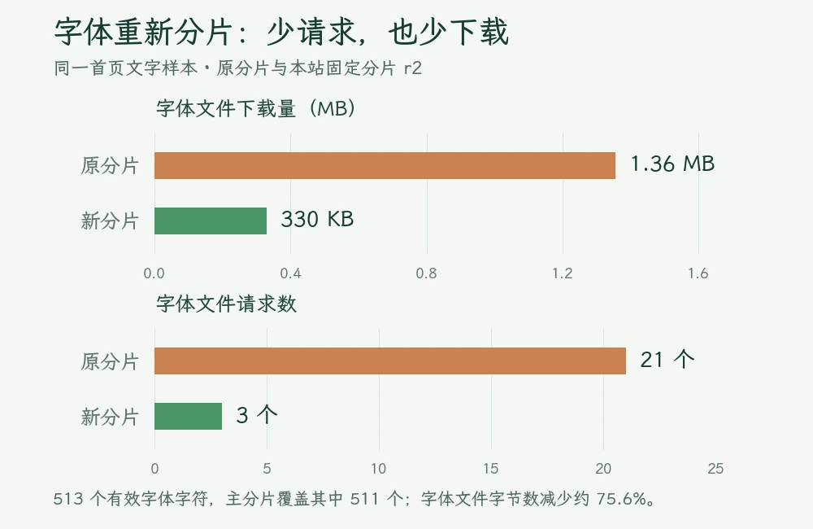

本来以为，本站的优选加速系列早就该完结了。

从最初给 [Cloudflare 全家桶接入优选 IP](https://www.ybjun.com/posts/cloudflare-youxuan-accelrate/)，到后来[改造背景、字体和 Loading 的第二轮提速](https://www.ybjun.com/posts/blog-accelrate-pt2/)，再到把 [Cloudflare-BestIP 搬进 NAS 自建优选](https://www.ybjun.com/posts/cf-bestip-youxuan-caution/)，博主确实在这件事上花了不少心思。日常打开自己的博客，感觉也已经挺快了。

但最近换成**一个从来没访问过本站的浏览器，在正常大陆网络中完全直连**，熟悉的转圈圈居然又回来了。而在公众号发出 Windows Insider 壁纸文章后，有读者也反映**链接打不开** 。更离谱的是，原本设计了“加载超过 15 秒就提示刷新或换域名”的小提示，这时候也跟着失踪了。换到海外网络，页面却能很快打开。

好家伙，缓存和日常使用习惯，差点把博主自己也给“优化”进去了。

于是，这次干脆从零缓存访问出发，把 DNS、真实 HTTPS 下载、HTML 解析、脚本启动、图片、CSS、字体和侧栏组件挨个检查了一遍。结果发现，**问题还真不止优选 IP：** 有些资源该少下一点，有些代码该早点执行，还有些东西，明明只是换了个位置显示，却悄悄在后台多干了好几份活。

本文就把这轮折腾完整记下来。算是承接前面几篇文章，给本站现有架构下的大陆访问优化，补上最后一块比较大的拼图。

## 1 自建优选很努力，但“本地最优”未必适合全国访客

### 1.1 NAS 测出来的好线路，访客走的可能是另一条路

之前自建优选的想法其实很直接：既然公共节点经常变化，那就让 NAS 定时测速，把自己这里最快的 IP 自动写回 DNS。

问题出在**“自己这里最快”**这几个字上。

测速程序部署在哪条宽带上，看到的就是那条宽带当时的路由、拥堵和运营商互联情况。同一个 Cloudflare 边缘地址，在博主的网络里表现不错，到了另一个地区、另一家运营商那里，可能就会出现握手慢、下载断断续续，甚至连接不上的情况。

而 DNS 一旦把这组地址交给全站访客，大家就都得跟着这份本地成绩单走。自建程序没有偷懒，只是它能看到的网络环境，与博客真正面向的访问范围，并不完全相同。

**所以这次先把 NAS 的自动更新任务停下来，重新挑选公共优选源，并把测试范围扩展到不同地区、不同运营商。**



### 1.2 443 端口能通，只是第一关

前几篇文章里，博主使用公共优选源时，经常用 TCPing 看一片绿油油的结果。这次排查则往前多走了几步：

1. 先看候选域名实际返回哪些 IP。
2. 用博客自己的域名作为 Host 和 TLS 的 SNI，逐个地址访问。
3. 正常验证 HTTPS 证书，检查返回的确实是本站内容。
4. 继续下载，确认 HTML 能完整收到，而不只停在一个 HTTP 200。
5. 再通过 Globalping 的电信、联通、移动探针，补上不同地区的链路和 HTTPS 观测。

这一测就很有意思了：**有些地址 TCP 连接很快，真正访问博客却返回 Cloudflare 1034；还有些已经返回 200，正文下载到一半就慢得挪不动了。**

对访客而言，页面能不能正常打开，比测速表里少几十毫秒更重要。这轮几组候选的情况大致如下：

| 候选源 | 本机直连、完整网页检查 | 三网 TCP 探针记录 |
| --- | --- | --- |
| WeTest 公共优选 | 5 个 IPv4 各测两次，7/10 次完整收到正文；成功样本耗时中位约 1.00 秒 | 10 个有效探针，未出现链路失败 |
| `cf.877774.xyz` | 2 个 IPv4 各测两次，2/4 次完整；成功样本耗时中位约 3.63 秒 | 9 个有效探针，未出现链路失败 |
| `cloudflare.19931110.xyz` | 部分地址很快，但池中出现了不适用于本站的 1034 响应 | 7 个有效探针，其中出现 1 次链路失败 |

结合本机的完整下载和多地探针结果，最终选用了 **WeTest 的公共优选源**。切换后的主站 HTTPS 复测中，一轮 8 个国内探针均返回 200，成功样本总耗时中位约 1.34 秒。

这里也算是给之前的折腾补了一课：优选要测到网站真正使用的那一层。只盯着一个 ping 值，容易把“端口敲开了”和“文章能看了”当成同一件事。

### 1.3 继续使用统一入口，把壁纸和取色也接上来

架构上，仍然沿用第一篇文章中的统一中转点 `cdn.ybjun.com`。清掉原有自建任务写入的 A、AAAA 记录后，将它改为一个公共优选 CNAME，代理状态保持仅 DNS。

[WeTest 的服务页面](https://www.wetest.vip/page/cloudflare/cname.html)提供了 `*.cloudflare.182682.xyz` 这一类泛域名入口，可以使用自己的前缀。配置关系可以理解为：

```text
cdn.ybjun.com       CNAME  blog.cloudflare.182682.xyz
www.ybjun.com       CNAME  cdn.ybjun.com
wallfast.ybjun.com  CNAME  cdn.ybjun.com
```

其中，之前为了加速博客访问、减少大量请求而设置的必应每日一图作为壁纸的加载模式，博主这次也做了优选：以 `wallfast.ybjun.com` 作为壁纸服务的加速入口：在对应 Worker 上添加 `wallfast.ybjun.com/*` 路由，DNS 则指向同一个 `cdn`。博客前端获取背景图、自动取色时，都通过这一入口访问。

这样以后调整公共源，仍然只需要修改 `cdn` 这一处。原来的壁纸服务入口继续保留，其他使用这套壁纸服务的网站也能正常工作。

顺便说一句，同一个主机名使用一个 CNAME 目标就够了，CNAME 记录也没有可以拿来排列故障切换顺序的“优先级”。这次是测完后选定一个目标，再统一切换。

### 1.4 图片真的下完，才算完成这一段加速

背景图和自动取色的请求，也做了新旧入口的交替直连测试。

其中一轮，原入口的图片在 20 秒时仍未完整下载；新入口的横图约 337 KB，1.45 秒收完，竖图约 358 KB，1.39 秒收完；取色请求约 0.73 秒。再配合多地 HTTPS 探针检查，以及图片内容、跨域响应的一致性核验，这条新的入口才算正式接入前端。

线路这部分终于顺了。接下来，就轮到前端自己交代：为什么网络有时已经通了，访客还得一直看转圈圈？

## 2 Loading 连超时提示都不显示，问题藏在它自己的启动顺序里

### 2.1 上一轮改成 DOMContentLoaded，为什么还会卡？

第二篇文章已经把 Loading 从等待 `window.onload`，改成了 DOM 就绪后退场，还加了一个 10 秒定时器。看起来，这套逻辑应该挺稳了。

但这次把模块脚本故意挂起后，问题就复现了：**控制 Loading 的代码自己也在模块加载链里。模块迟迟没有准备好，退场逻辑没开始执行，那个“10 秒兜底”当然也还没开始计时。**

另外，`DOMContentLoaded` 本身也要等待延迟脚本和模块脚本执行完成。HTML 已经解析出一大半，页面里也明明有正文，某个模块仍可能把这个事件往后拖。

这就解释了最令人迷惑的现象：明明设置了超时提示，等得比超时时间还久，它却根本不出来。给一个还没启动的程序加定时器，多少有点指望没上班的人准点打卡了。

### 2.2 把“放行正文”的控制器搬到最前面

这次把加载控制器独立为 `loadingBootstrap.astro`，作为**经典内联脚本**放在 `<head>` 的前部，早于样式和模块脚本执行。

它只做几件很基础的 DOM 操作，不等待组件、背景、主题取色或字体。页面解析完成、进入 `interactive` 状态后，就可以放行正文。

这个时机可以在 [MDN 的 `document.readyState` 说明](https://developer.mozilla.org/en-US/docs/Web/API/Document/readyState)里看到：`interactive` 表示文档已经解析完成，而模块等子资源仍可能在继续加载。

抽出关键部分，逻辑就是：

```astro
<script is:inline>
(() => {
    const root = document.documentElement;
    let finished = false;

    const finish = () => {
        if (finished) return;
        finished = true;
        root.classList.remove('is-loading', 'loading-slow');
        // 再完成遮罩淡出、初始动画等收尾
    };

    document.addEventListener('readystatechange', () => {
        if (document.readyState !== 'loading') finish();
    });

    if (document.readyState !== 'loading') finish();
    setTimeout(() => finish(), 10000);
})();
</script>
```

这里最关键的变化，是**让控制器本身先启动**。这样退场条件和计时器才有机会发挥作用。

### 2.3 8 秒给提示，10 秒让遮罩退场

长时间等待时的交互也一起整理了：

- 等待到 8 秒，显示居中的两行提示。
- 提供“刷新页面”和“换域名访问”两个入口，颜色跟随本站主题。
- 到 10 秒执行退场，已收到的页面内容先展示出来。
- 若 HTML 流还停留在 `<head>`、真正的遮罩甚至还没到达，就先创建一个独立提示；页面继续传输后再清理。

下图就是模拟加载受阻时，手机视口中出现的提示：


除了正常访问，还专门检查了模块挂起、HTML 传输中断、禁用 JavaScript 等情况。这样一来，即使某个装饰性资源慢了一拍，正文也不用陪着它一起罚站。

## 3 图片和图标减负：首屏少搬一点，效果往往很直接

### 3.1 文章封面，用原图多少有点奢侈

首页展示的是文章卡片，封面在屏幕上通常只有几百像素宽。但仓库里的一些旧封面，保存的仍然是尺寸很大的原始图片。

这就相当于为了看一张小预览，先把整张大图搬到访客电脑上。首页卡片一多，字体、脚本和背景也都得跟着挤带宽。

这次把有需要的文章封面统一整理为 **宽度至多 1000px、保持比例的 WebP**，小图不强行放大。处理的这一批 12 张旧封面，源文件合计从 **5,427,991 B 降到 328,958 B**，减少约 93.9%。

文章正文里的照片、壁纸原图仍按各自的用途提供；封面卡片则有了适合自己的尺寸。

### 3.2 把规范写进 CMS，避免以后又慢慢长回去

只处理一次历史文件还不够。博主后续写文章时，还是会继续上传新的封面。

因此，CMS 的封面上传流程也一起改了：选中图片后，先在浏览器内等比缩小、转为 WebP，立即显示压缩后的预览，并把待上传内容保存在浏览器的 IndexedDB 中。

等点击保存草稿或保存发布时，再把这份处理后的封面上传 GitHub，给 `index.md` 写入可以实际读取的相对地址。上传失败时保留本地待上传内容，方便继续重试。

这样，编辑时看到的是将要使用的封面，提交到仓库里的也是同一份文件，后面就不需要再隔一段时间手工清一遍大图了。

### 3.3 必应每日一图，横屏和竖屏不要一起抢带宽

另一笔可以直接省掉的请求，是改成每日一图作为背景后，遗留的一个 bug。

原先桌面横图和手机竖图都有对应元素，再通过 CSS 控制显示。问题在于，**图片被 CSS 隐藏，并不等于浏览器不会提前请求它。** 结果就是每次访问都会同时下载横、竖两张背景，不论什么设备、什么视口。

而现在每日壁纸模式，改为根据当前视口选择图片源，只请求当下需要的那个方向；横竖屏发生变化时，再处理新的方向。横幅背景和全屏背景也共享对应的请求状态。

同时，给每日图片加上每次 8 秒的等待截止：首次失败后再重试两次，连续失败就使用原有 `wallpaper_fallback` 目录中的兜底横图或竖图。配置里的 `isdailywall` 继续决定使用每日美图还是 Twilight 主题原来的壁纸系统。

一张图能解决的事情，就让一张图来。访客打开文章，不需要先参加一场横竖屏壁纸的下载比赛。

### 3.4 小图标，也别再绕去外站找

排查中还发现，站内一部分图标虽然只是一小块 SVG，运行时却仍会去请求外部 Iconify API。图标本身不大，但多出来的域名解析、连接和偶发超时，足以让按钮上空出一个小洞。

这次改为从本地安装的官方图标集中提取本站实际使用的图标，生成一份精简数据。Astro 侧直接输出 SVG，Svelte 侧使用离线渲染器，并保留原有尺寸、主题色和悬停样式。

最终提取了约 100 个实际使用的图标。网络记录里，相应的外部图标 API 请求消失了，页面也少了一条“等外站把图标送来”的依赖。

### 3.5 友链头像和关于页，也得按实际用途瘦一圈

首页的封面处理完后，博主又顺着访问过程，发现友链里的两张本地头像和关于页底下的照片还是有点慢。

这几张图已经放在博客自己的仓库里，跟着主站走优选。问题倒也朴素：**同源能省去额外的连接，但不会替图片自动减肥。** 尤其是其中一张头像，页面里只显示一个小圆圈，文件却还是一张千余像素、六百多 KB 的 PNG。

于是，两个本地头像统一裁切、缩小为 **256 × 256 的 WebP**；关于页底图则保持 **2000 × 1333** 的原有尺寸，只转换格式。配置和正文引用一起换成新文件名，旧的大图也从仓库里清掉。

| 图片 | 原文件 | 处理后 |
| --- | ---: | ---: |
| 友链头像一 | 37,187 B | 5,736 B |
| 友链头像二 | 637,199 B | 10,216 B |
| 关于页底图 | 248,404 B | 139,808 B |

三张图合计从 **922,790 B 降到 155,760 B**，减少约 83.1%。图片仍然是原来的图片，只是小头像终于不用背着大原图出门了。

## 4 非关键 CSS：不是每个页面都需要先收到整套工具箱

### 4.1 约 270 KB 的内联样式，先把 HTML 撑胖了

继续看首页的 HTML，另一个大头是样式：CSS 拆分前，单页内联 CSS 约 **272,496 B**。

其中有一部分属于正文基础布局，有一部分则是图片灯箱、数学公式等特定功能。即使只是打开首页，访客也会先收到一批眼下根本用不上的样式。

而且，**这些内容直接塞在 `<head>` 中。** 网络传得慢时，浏览器要先接收这一大段，后面的正文结构才能继续到达。

### 4.2 保留基础样式，把功能样式交给真正用到它的地方

这次拆分没有按文件大小“一刀切”，而是按用途来：

- 布局、主题色、导航、首屏等基础样式继续及时提供。
- 图片灯箱的样式在打开图片时按需加载，多个触发点复用同一份加载状态。
- KaTeX 样式随含公式的文章输出，普通首页不必预先携带。
- 功能资源已经加载过后继续复用，避免反复下载或重复插入。

灯箱还要保证样式准备好再弹出。否则网络上是省了一点，视觉上却先冒出一个没穿好衣服的弹窗，多少也有点得不偿失。

加载部分使用了 [Vite 的 CSS 内联导入](https://vite.dev/guide/features.html#disabling-css-injection-into-the-page)，通过 `?inline` 把 CSS 作为字符串随懒加载模块带过来，再统一插入页面：

```typescript
const [mod, baseStyles, customStyles] = await Promise.all([
    import('@fancyapps/ui'),
    import('@fancyapps/ui/dist/fancybox/fancybox.css?inline'),
    import('@styles/fancybox.css?inline'),
]);

const cssText = `${baseStyles.default}\n${customStyles.default}`;
```

外层保存同一份加载 Promise，完成后缓存模块和样式内容。这样既能让第一次点击等到正确样式，也能让后续打开图片直接复用。

### 4.3 这一阶段的产物对比

| 项目 | CSS 拆分前 | 拆分后的阶段产物 |
| --- | ---: | ---: |
| 首页内联 CSS | 272,496 B | 211,324 B |
| 首页 HTML | 495,342 B | 464,992 B |
| 首页 HTML gzip，同参数压缩 | 93,021 B | 83,750 B |

可以看到，这一步并没有把所有内联 CSS 都清空，而是先拿走那些可以晚一点出现的功能。随后再检查图片灯箱实际打开、公式文章显示、站内切页等交互，确认样式拆开之后，功能依然完整。

## 5 字体重新分片：这次终于不只是把文件搬回本地了

### 5.1 已经同源、已经并行，为什么霞鹜文楷还是慢？

本站用的霞鹜文楷，之前已经脱离公共字体 CDN，文件放回博客仓库，也有异步样式和系统字体回退。这次起初还怀疑，会不会是浏览器没有把分片并行起来。

但网络记录给出了一个挺明确的结果：字体索引加载完成后，21 个分片几乎同时发起，完成的请求也确实在同一条 HTTP/2 连接上。代码里没有一个接一个 `await` 下载字体的循环。

真正让人挠头的是另一件事：**当前首页需要的字符，被分散到了太多分片里。**

原先这套字体共有 253 个 WOFF2 分片，完整字体 CSS 约 217 KB。首页的一组文字样本里，513 个有效字体字符命中了 21 片，合计约 1.36 MB。有的分片只为了一个字就得下载六十多 KB，两个常用标点所在的分片加起来也有一百多 KB。

分片机制确实在工作，只是这份分组并没有特别照顾本站的导航、标题、侧栏和常写内容。

### 5.2 按本站的字频，制定四层固定名单

既然问题在分配，博主干脆自己来，所以写了一个分片工具。制作使用 [FontTools 的字体子集功能](https://fonttools.readthedocs.io/en/latest/subset/index.html)，保留正在使用的屏幕阅读版、Regular 400 规格，把输出做成浏览器使用的 WOFF2。

第一步不是急着切文件，而是先统计现有 **25 篇文章、14 条日记**，加上站点 UI、导航、侧栏、文章标题、分类标签等内容，整理一份适合本站的固定名单。

目前采用四层：

| 层级 | 放什么 | 当前规模 |
| --- | --- | --- |
| 主分片 | 固定 UI、字母数字、常用标点、通用常用字、标题和标签中的高频字 | 1000 字，1 片 |
| 其余常用汉字 | GB2312 范围内的其他汉字，按正文使用频率排序 | 5938 字，47 片，每片至多 128 字 |
| 其他汉字 | 本站用过的其他汉字及完整字库中的除 GB2312 外的其余汉字 | 24551 字，96 片 |
| 外语和符号 | 其它外语字符、组合字符及符号 | 16394 字，47 片 |

这样，导航里反复出现的字、标题里经常用的字，就能尽量聚集在前面。生僻字、韩文、日文等内容也有自己的位置，音乐文章照样能正常写。

制作完成后，全部 **47883 个字符**都进行了覆盖和字宽检查，另外做了 1800 处字形轮廓比较，并核对了 41 条 Unicode 变体序列。换的是打包方式，屏幕上看到的仍然是同一个字型。

### 5.3 主片优先，其余按页面实际字符并行加载

最终的 1000 字主分片约 **242.7 KiB**。前端把它的 `@font-face` 声明直接放进页面，并加一个高优先级的字体 preload，让浏览器尽早发现它。

在 `fontLoader.astro` 中，针对本站这套分片插入的核心部分如下。`criticalCss` 和 `preload` 地址都由制作程序生成，更新字体时跟随 manifest 一起变化：

```astro
---
import fontManifest from '../../public/assets/LXGWWenKai/manifest.json';
---

<style is:inline set:html={fontManifest.criticalCss} />
{fontManifest.preload.map(font => (
    <link
        rel="preload"
        as="font"
        href={font.href}
        type="font/woff2"
        crossorigin="anonymous"
        fetchpriority="high"
    />
))}
```

完整字体索引依然异步加载，其他分片交给 `unicode-range` 按需选择。这个机制在 [MDN 的说明](https://developer.mozilla.org/en-US/docs/Web/CSS/Reference/At-rules/@font-face/unicode-range)中也很直观：页面用到某个范围内的字符，才需要相应的字体文件。

加载关系大致如下：



这里的四个层级，是制作和组织名单的方式。浏览器可以并行下载页面需要的几个文件，不用排队等主片下完，再去下第二层、第三层。

字体显示继续采用 `swap`：文件到达之前先用系统字体，随后切换为霞鹜文楷。冷访问时仍然能看到这个变化，个别标题的换行也可能跟着调整；主片的作用，是让大部分 UI 和高频文字集中完成切换，缩短零零散散“补字”的过程。

### 5.4 分片少一点，文件也未必就省一点

制作时还走了一小段弯路。

最初为了压低请求数量，常用字尝试过每片放 384 字。但在音乐分享这类文章里，只要碰到几个分散的字，就会把一批较大的分片都带下来。该文章的字体需求估算一度达到约 1.54 MB。

把这一层保持原顺序细分为每片至多 128 字后，同一篇文章降到了约 1.06 MB。首页也从初版约 401 KB，进一步降到约 330 KB。

所以这次没有执着于“文件越少越好”，而是在请求数量和每次多下载的内容之间，找一个更适合当前文章的大小。

### 5.5 相同文字，重新测一遍

先取相同的首页文字，比较实际需要的字体文件：

| 项目 | 原分片 | 新分片 |
| --- | ---: | ---: |
| 字体文件请求 | 21 个 | 3 个 |
| 字体文件合计 | 1,355,556 B | 330,232 B |
| 主分片覆盖的样本字符 | — | 511 / 513 |

这一组文字的字体下载量减少约 **75.6%**。真实首页还有时钟、问候语等动态内容，实际检查中会再命中少量分片，本轮完整首页请求了约 5 个文楷分片。



接着，新开浏览器上下文、关闭浏览器缓存，按“旧版 → 新版 → 新版 → 旧版”的顺序测字体就绪时间：

| 测试环境 | 原分片 | 新分片 |
| --- | ---: | ---: |
| HTTP/2，150ms 延迟、1Mbps 下载 | 12.13–12.16 秒 | 约 3.48 秒 |
| 本机大陆直连，预览域名原始解析 | 14.07–16.45 秒 | 6.29–8.67 秒 |
| 本机大陆直连，固定到主站命中的同一优选 IP | 3.23–4.20 秒 | 2.19–2.69 秒 |

最后一组只在测试浏览器内指定连接到同一个优选地址，保留预览域名的 TLS 和 Host，让两版字体走同一入口进行比较。表里记录的是字体就绪，正文则会先用系统字体显示。

除了首页，关于页的静态文字字体需求从约 1.04 MB 降到了 0.70 MB，资源汇总页从约 1.22 MB 降到了 0.62 MB。主分片没有继续削小，这一版已经有了比较直接的收益。

### 5.6 字体更新，也得留一条省心的路

博主当然不想上游一更新，就重新手搓一轮字体。因此，程序已经整理进了前端仓库的 [`font-slicer` 目录](https://github.com/ElliottZhao666666/ybjun-blog/tree/main/font-slicer)。

在 Windows 安装好 Python 3.12 后，可以直接双击里面的 `run.cmd`，也可以在仓库根目录运行：

```powershell
# 获取上游最新的固定规格字体，分片、校验、备份并导入博客
.\font-slicer\run.ps1 update

# 只制作和检查，先不导入
.\font-slicer\run.ps1 update --no-import
```

这个流程会沿用固定名单。更新字体版本时，不会因为博主又写了一篇新文章，就把原有分片自动洗牌；新加入字库的字符先进入独立的尾部分片，后面再按实际需要手动调整。

工具生成的缓存、源 TTF、日志和试验结果留在本地，仓库里保存程序、规则和测试代码，最终使用的字体产物仍放在博客原来的字体目录。一次制作时把链路理顺，后面的更新就能少折腾很多。

## 6 侧栏显示好几份，后台数据就不必也加载好几份了

### 6.1 PV 为什么切个页面就加两次？

字体之外，博主还注意到侧栏的数据经常姗姗来迟。页面已经出来了，运行天数、访客信息却还在等；切换几个页面，PV 的增长又有点过于“热情”。

从代码看，这跟博主**早期没搞明白 Twilight 的侧栏逻辑时，就手搓硬补丁**有绝对的关系：为了让侧栏在不同宽度下摆在合适的位置，统计组件实际放了三份，分别位于左栏、右栏和手机底栏。

布局确实摆对了，但三份组件都使用 `client:load` 启动。**CSS 把其中两份藏起来，并不会阻止它们运行。** 首次访问，三份组件各自上报一次；站内切页时，左右栏被重新替换，又可能多上报两次。并且三份相同组件的加载，也会显著拖慢加载速度。

**显示层做了响应式，后台工作却没有跟着响应式，这下问题就找到了。**

### 6.2 保留显示位置，把数据和上报收回同一处

这次继续沿用桌面双栏、平板左栏、手机底栏的原有布局，在加载和数据层做调整：

1. 统计与访客组件使用 Astro 的 `client:media`，当前视口匹配哪一份，就先启动哪一份。
2. 页面访问上报由页面级逻辑统一触发，重复的生命周期通知会去重，组件自己不再各报各的。
3. 不同展示位置订阅同一份统计状态，复用正在进行的请求和已有结果。
4. 首次读取、上报和后续刷新按各自职责工作，避免把所有数字都堵在一个慢上报请求后面。
5. 运行天数、最后更新时间等可在本地算出的内容，直接在初始 HTML 中给出，浏览器启动后再校准。

访客信息同样复用进行中的请求与短时间内的结果，减少重复加载。这份复用在当前浏览器内存里完成，改变窗口宽度后，不必为了显示到另一个位置再查一次。

对需要联网的读取增加截止时间，有上次的公开统计时继续显示，页面就不再是一排空位等结果。

### 6.3 计数回到页面访问本来的意思

修复前后，上报 PV 次数的对照很直观：

| 操作 | 修改前 | 修改后 |
| --- | ---: | ---: |
| 首次打开页面 | 3 次 | 1 次 |
| 站内切换一个页面 | 2 次 | 1 次 |
| 改变窗口宽度 | 容易触发额外组件工作 | 不增加访问上报 |
| 同一页切换锚点 | — | 不增加访问上报 |

把这件事做好后，统计数字也终于没有那么自来熟了，首页加载速度也能再快一点点。

### 6.4 手机底栏，也顺手补齐了该有的内容

数据加载理顺之后，手机底栏的组件顺序也统一为：**个人名片 → 公告 → 分类 → 标签 → 站点统计 → 访客信息**。

桌面继续左右分布，平板继续使用左栏。手机文章页的目录交给浮动 TOC，底栏不再堆一份固定目录；平板则仍保留侧栏里的固定目录。

最后分别测试了桌面、平板、手机、连续缩放、站内切页和跳转，确认显示位置与计数能各做各的事。页面上可以有几处显示窗口，背后的数据不必也各干几遍。

## 7 首页开得快，点进文章却没反应，Swup 还在等谁？

### 7.1 正文已经出来，切页程序却还没上班

前面这一轮完成后，博主又用北京联通教育网，打开一个全新的 InPrivate 窗口直连本站。这次首页确实快了：文章封面几乎马上出现，再等一小会儿，背景和统计也陆续补齐。

但接着点顶栏里的文章、日记、友链、关于，或者随便打开一篇靠后的文章，新的问题来了：**按钮看起来能点，页面却迟迟没有动静。过十几秒再试，又大概率能打开；原有切页动画也像被赶着走，一闪就过去了。**

检查下来，这次的主角是 Swup。本站靠它完成站内切页、内容替换和过渡动画，而原来的配置会等到 `window.load` 之后，再挑空闲时间启动。

这跟前面首屏 Loading 的问题，还真有点异曲同工：HTML 已经解析好了，正文也能看了，不代表整页的资源都已经加载完成。一张背景、一份字体，或者一个迟迟没有结束的请求，都可能把 `window.load` 往后推。结果就是，**首页先交到了访客手上，负责站内切页的程序却还在等资源收尾。**

如果只在有缓存的浏览器里检查，很容易觉得一切正常。换成第一次来的访客，这段“页面看着好了，交互还没完全准备好”的空当，就特别明显。

### 7.2 Swup 提前启动，预取也只干一份活

这次先把 Swup 的启动前置，不再等整个页面加载完，再等浏览器有空。缓存、悬停预取和原来的动画继续保留，配置中的关键变化很小：

```javascript
swup({
    loadOnIdle: false,
    preload: true,
    cache: true,
    // 其余容器、动画与历史记录配置继续沿用
});
```

继续追请求时，又发现了两处重复劳动。

第一处是**浏览器和 Swup 都想帮忙预取**。Cloudflare 的 Speed Brain 可以通过浏览器的推测规则提前读取页面，Swup 自己也会在悬停链接时预取。如果两边同时盯着同一条链接，就可能各发一份请求。

第二处更细：当前版本的预取插件，保存进行中的请求时用完整 URL，正式切页取这份请求时却用相对路径。明明同一个目标已经在下载，另一次查找却没对上，于是又发一遍。

现在把这两件事分别理顺：

1. 普通站内链接交给 Swup 预取和复用缓存；明确退出 Swup 的同源普通链接，再按本站提供的推测规则参与浏览器预取。
2. 正式导航查找进行中的预取时，同时兼容完整 URL 和相对路径，复用同一个 Promise。
3. 预取失败，可以重新正常请求；但已经取消的切页，就不要再追着补发请求。

Speed Brain 的能力仍保留，通过本站自己的 `Speculation-Rules` 响应头划分范围。这样，访客把鼠标挪到链接上、紧接着点下去时，后台终于能认出：哦，这份就是刚才已经开始拿的页面。

### 7.3 首次打开和站内切页，需要两套不同的等待反馈

Swup 提前开始工作后，网络偶尔慢一点时，应该显示什么？

直接把首屏 Loading 再放一遍，看起来好像省事，但首次进站和站内切页其实是两回事：第一次打开时，访客可能还没看到正文；切页时，眼前明明已经有一篇可以继续读的内容。每次都把整页重新遮住，再重播一次首屏入场动画，反而容易让人觉得网站又从头加载了。

这次把两者分开：**首屏继续使用前面那套独立控制器，站内切页则使用专门的等待状态。**

| 从点击开始 | 页面表现 |
| --- | --- |
| 前 300 毫秒 | 保留当前页面，不额外打扰 |
| 超过 300 毫秒 | 顶部出现轻量进度条，缓慢向前推进 |
| 超过 6 秒，新内容仍未就绪 | 显示带“取消”按钮的 Loading，原页面保留在后面 |
| 新内容准备好 | 继续执行 Swup 原有的退场、替换和入场动画 |
| 整次切页超过 17 秒 | 结束本次等待，恢复页面操作，并给出失败提示 |

顶部进度条表示“这次切页正在进行”，并不是下载百分比。每次点击都从起点按等待时长向前推进，新内容准备好便立即补满、淡出；等到上限仍没完成，就交给错误提示。系统开启“减少动态效果”时，也保留同样的进度数值，避免把等待中的进度条直接显示成满格。

下面是在桌面视口中，模拟目标页面迟迟没有返回的等待状态。页面没有消失，等得不耐烦时，直接点“取消”或按 Esc 即可：


这套反馈接在全站共用的 Swup 生命周期上。首页、文章、归档、分类标签、日记、相册、友链、关于等页面之间切换，都能使用；页内锚点、下载和新标签页打开，则各自按原来的方式工作。

### 7.4 超时要管到正文收完，不能收到响应头就算交差

排查请求截止时，还遇到了一个容易漏掉的细节：有时服务器很快返回了响应头，状态也是 200，但 HTML 正文的传输一直没有结束。

如果计时器只管到 `fetch()` 返回，就会在响应头到达后提前收工。后面的 `response.text()` 仍然可以等很久，页面也就继续卡着。**“服务器开始回答了”和“下一页已经拿完整了”，并不是同一个时刻。**

所以现在的截止逻辑，会一直覆盖到 HTML 正文读取完成；整次切页另有同样从点击起算的 17 秒总上限，避免取页完成后，又卡在必要样式或切换阶段。两道限制共同工作，先到的那一道结束等待。

服务器明确返回 HTTP 错误，或者拿到的页面缺少本站必需的内容容器，则直接提示失败，不必继续空等。背景、字体和统计这些后续资源，也不再被当作“文章能不能打开”的前提。

失败提示里保留“重试”“新标签页打开”和“关闭提示”，末尾附上简短原因，例如等待超时、HTTP 状态码或网络连接异常。关闭按钮带 10 秒倒计时，时间到了自行收起；想接着操作，也可以提前关掉。


“新标签页打开”使用浏览器正常的整页加载，跳过这一次 Swup 切换。原来正在看的内容留在原标签页，访客可以自己选择接着等、换条路打开，还是先读点别的。

### 7.5 取消等待，不能把地址栏和页面一起留在半路

加一个取消按钮不难，难的是点完之后，网站得真的回到一个完整、可操作的状态。

Swup 切页过程中会更新历史记录、处理页面头部、准备动画，本站还会跟着调整首页 Banner 和导航栏。如果只把 Loading 藏起来，后台请求可能仍在继续；旧页面还在，地址栏却已经到了下一页；更晚到达的响应，甚至可能又把访客刚打开的其他页面盖过去。

因此，这次把取消和失败恢复也做完整：中止相应请求、清理计时器和动画状态；内容还没替换时，恢复当前页面对应的地址、历史记录和布局；新内容已经替换时，则保留它，结束未完成的切换效果。

首页 Banner 和布局变化也推迟到真正开始退场的时候。这样，网络慢的时候，眼前仍是一张完整的旧页面，不会先把首页标题和导航改成下一页的样子，再晾着访客等。

连续点击另一个目标、前进后退、取消后重试，都按同一套状态处理。Loading 只是反馈，不能顺手把浏览器的正常导航秩序也搅乱了。

### 7.6 不只测“能打开”，也要测“打不开时怎么办”

这次检查既跑正常切页，也专门模拟了响应缓慢、HTTP 503、响应头已经到达但正文挂起、切换阶段迟迟不结束等情况，还检查了取消、重试、连续换目标、前进后退和手机深色模式。

其中一个比较有代表性的线上测试，是让背景图片继续保持未完成状态，再立刻点击站内链接：**文档仍处于 `interactive`、整页加载尚未结束时，Swup 已经接管切页，目标文章可以正常打开。** 悬停后紧接着点击的目标，也只产生了一次 Swup 请求，没有再多一份浏览器预取。

调整为 6 秒等待提示、17 秒超时和 10 秒自动收起后，又对这些节点、新标签页入口以及不同页面的进度条逐项复测。正常切页保留原有动画，遇到波动时则有清楚的等待、取消和恢复路径。

折腾到这里，首页快和站内浏览顺畅，才终于接上了同一条线。总不能门口修得漂漂亮亮，访客一进来，却发现每扇房门都得多推几次吧。

## 8 这一轮结束，终于可以安心写点别的了

回头看这次改造，真正有效的动作，大多都能归到几个很朴素的方向：**线路要选对，资源少搬一点，正文早点放行，同一份工作尽量只做一次。**

换公共优选源解决了入口选择的问题；Loading 控制器让慢资源不再把正文一起拦住；封面、背景、友链图片和图标减少了资源负担；非关键 CSS 回到了自己的使用场景；字体分片开始适应本站的文字；侧栏把重复请求和计数收了回来；最后再让 Swup 提前接管切页，把预取复用、等待反馈和失败恢复接完整。

如果把前面几篇和这次的工作放在一起，这几轮优选加速，大致可以汇总成下面这张图：

```mermaid
flowchart TB
    A[本站优选加速：阶段收官]

    A --> B[网络入口与服务接入]
    B --> B1[统一 CNAME 中转点<br/>多地三网实测选择公共优选源]
    B1 --> B2[Pages 代理 · Workers 路由<br/>R2 云连接器]

    A --> C[页面加载与背景]
    C --> C1[控制器前置 · HTML 解析后放行<br/>8 秒提示 · 10 秒解除遮罩]
    C1 --> C2[背景流式传输 · 按视口选图<br/>重试与本地兜底]
    C2 --> C3[Swup 提前启动 · 预取去重<br/>6 秒可取消等待 · 17 秒超时恢复]

    A --> D[静态资源与字体]
    D --> D1[封面与小图 WebP · 图标同源<br/>非关键 CSS 按功能加载]
    D1 --> D2[字体同源 · 四层固定名单<br/>主分片优先 · 其他字符按需并行]

    A --> E[动态组件与后续维护]
    E --> E1[侧栏按视口启动 · 数据共享<br/>页面访问上报去重]
    E1 --> E2[冷访问与故障回归<br/>可复用字体工具 · Git 到 Pages 自动发布]

    B2 --> Z[正文更早可读<br/>资源陆续补齐 · 后续更新有章可循]
    C3 --> Z
    D2 --> Z
    E2 --> Z
```



在完成背景与图标改造的一次主站冷访问记录中，HTML 约 1.50 秒接收完毕，遮罩约 2.27 秒开始退场，`DOMContentLoaded` 约 3.00 秒。对博主来说，比起这些时间数字，更舒服的变化是：**现在访客能先看到文章，再等背景、字体和动态数据陆续补齐。** 博客终于把“给人看内容”这件事，重新排在了装饰和小组件前面。

从五月第一次给 CF 全家桶做优选，到后来自己跑测速、改背景、改字体，再到这次把整条加载链拆开重新检查，绕的弯路真不少。不过折腾到这里，在继续使用现有主题和托管架构的前提下，博主能动手抠出的那些大块等待，基本都已经认真抠过一遍了。

所以这篇，就先作为本站优选加速系列的最终章。网络会变化，博客内容也会继续增加，后面遇到实际问题，或者积累了更适合的字体分组，仍然会接着调整。至于下一次大动干戈，或许真要等博主哪天想不开，给全站换一套架构的时候了。

这阵子转圈圈的活儿就先到这里。博主也该把时间还给文章、照片和音乐，少看几眼网络瀑布图了。
