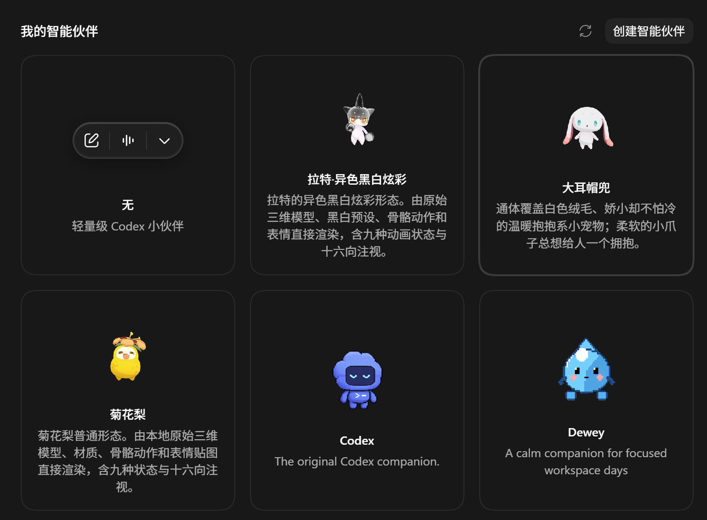
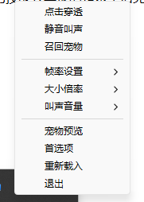
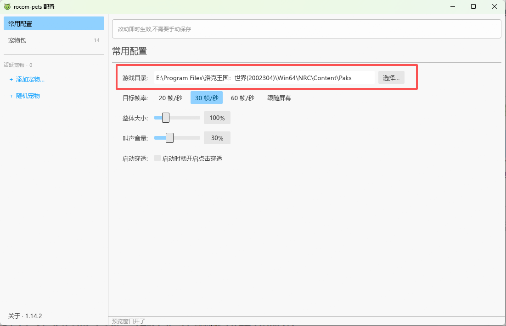
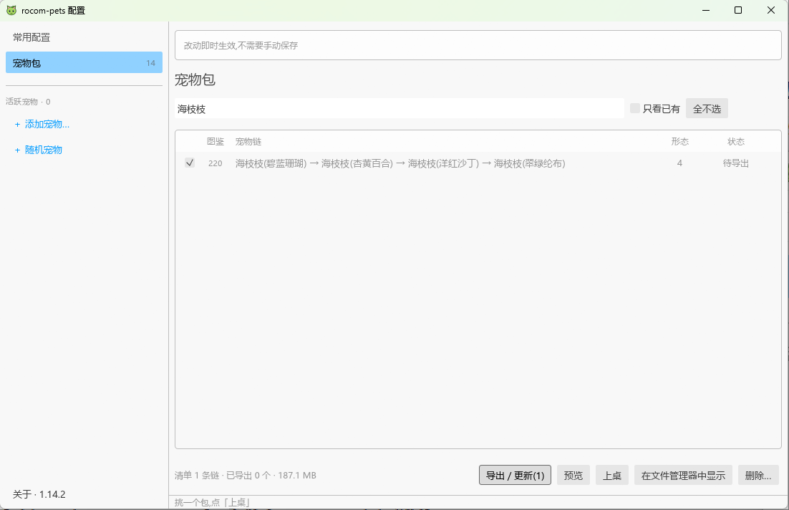
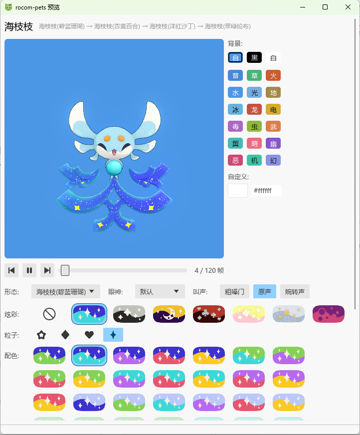
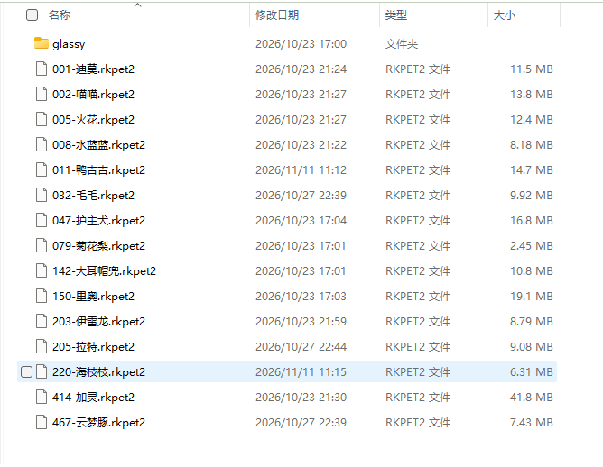
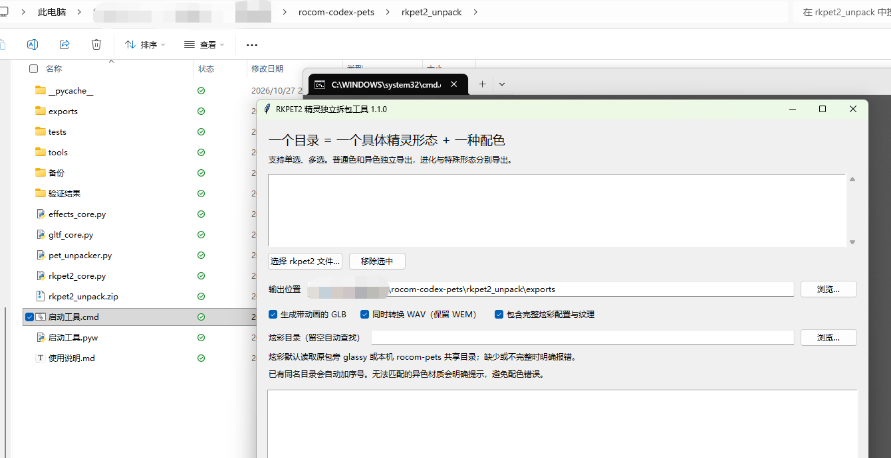

本文通过一个实际的例子，简要介绍使用博主开发的 Codex 技能 `rocom-codex-pets-gen` 技能，将洛克王国世界的宠物资源提取出来，并生成 Codex 桌宠的全过程。

技能的仓库如下，可以先给 Codex 安装此技能后再沿着本文照做。**需要注意的是，如果你有能力直接按照仓库内的文件结构要求准备宠物资源文件，那你无需查看本文，本文最主要是要介绍一种拿到宠物资源的办法。**

::github{repo="ElliottZhao666666/rocom-codex-pets-gen"}

## 准备工作

在开始本文流程之前，你需要确保已经完成以下操作：

* 电脑已经安装《洛克王国：世界》并更新到最新版本。
* 准备好 `rocom-pets` 最新版主程序，接下来的资源准备流程需要借助这个软件实现。获取方法见下方。
* 电脑已安装 Python 3.11+。以及 Codex 桌面版。

其中 `rocom-pets` 是`whoisnian` 开发的一款桌宠软件，可以提取洛克王国宠物资源并将其显示在桌面上，作为桌宠与用户互动，所有动作、音效、表情逻辑都遵循原游戏。不过目前这个桌宠还没有其他功能。我们的技能要实现的是基于洛克王国原始宠物资源，生成对应的 Codex 虚拟宠物。

大家可以到 Release 页面下载到最新版：

::github{repo="whoisnian/rocom-pets"}

## 提取资源

接下来，我们以制作 **海枝枝-碧蓝珊瑚-蓝青四角星炫彩** 为例，演示资源提取方法：

运行`rocom-pets`主程序，初次运行，桌面不会有反应，但应该有托盘图标了，直接点击**首选项**进入设置。

在**常用配置**中设置游戏目录，选择到游戏目录的`Paks`文件夹：

点击**添加宠物**，右侧搜索“海枝枝”，勾选，点击**导出/更新**，等待打包完成。

打包完成后，可以点击预览按钮，预先选择你的目标属性，查看效果如何。通过这个阶段的预览，你可以看到该精灵所有形态、异色、炫彩搭配的样式，并最终确定你想要做的样式，后续 Agent 都可以做。我们就直接确定**海枝枝-碧蓝珊瑚-蓝青四角星炫彩**。

关闭预览界面，点击宠物列表右下角**在文件管理器显示**，打开备用。在这里你可以看到所有导出打包的精灵。

## 转换精灵资源

接下来，我们需要将这些导出的`*.rkpet2`资源包，转换为我们的 Skill 可以输入的精灵资源文件形式。可以用到博主写的一个小程序。[下载地址](https://wres.ybjun.com/blog222/rkpet2_unpack.zip)

下载并完成解压，管理员身份运行`启动工具.cmd`，出现如下窗口：

