最近有群晖 NAS 的朋友，应该都有点“提心吊胆”。原本只是刷刷技术资讯，结果接连看到 NAS 被加密、文件打不开的消息；再看一眼自己角落里那台闪着绿灯的机器，多少也会有些不放心。

博主的 **DS920+** 就是这样。它承担着文件存储、电脑备份、资料同步，还跑了不少套件和 Docker 服务。为了方便使用，配置也一直比较宽松。

这次检查之前，它的状态大致是：**防火墙没有开启，通过公网 IPv6 和 DDNS 直接外联，套件与容器不断增加，系统更新没有及时跟进，共享文件夹也没有形成完整的快照保护。**系统当时运行的是 **DSM 7.3.1-86003 Update 1**。

以前觉得这些设置方便，出了这轮事情，就不能继续放羊了。设备坏了可以换，服务停了可以重搭，攒下来的工作资料、照片和备份文件可经不起这么折腾。毕竟，数据无价。

于是，博主给这台 NAS 做了一轮检查和加固：更新系统，补上快照，设置防火墙，调整远程访问，再顺手清理一些多年积累的旧配置。本文总结了这轮操作后的经验和心得，希望能给同样在使用群晖、需要外网访问和防范勒索病毒的朋友一些参考。

## 1. 病毒来袭

先说说这次究竟出了什么问题。以下信息整理到 **2026 年 11 月 1 日**，主要依据群晖安全公告、360 反勒索团队的样本分析和 PHP 官方说明。

从已公开的漏洞与攻击资料来看，值得关注的主要有下面三条线。

### 本轮 DSM 漏洞

群晖在 9 月 18 日发布的 **SA-26:13** 公告，涉及 CVE-2026-13639、CVE-2026-13684，问题落在 DSM 登录认证及相关请求处理环节，可能造成任意文件读写等后果。

360 在 10 月 29 日公布的分析，将一批实际攻击样本指向 **Cerber 的 C3RB3R 变种**，并关联到上述漏洞。样本会给加密文件添加 `.L0CK3D` 后缀，留下 `read-me3.txt` 勒索信。

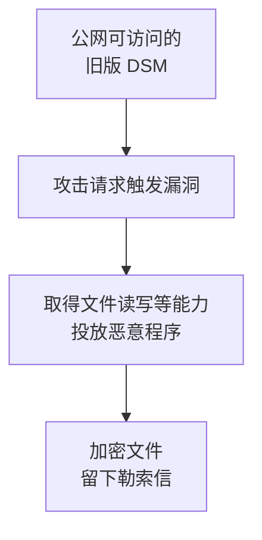

### 旧漏洞与驻留

另一条线，是过去已经出现过的 DSM 漏洞和入侵后的驻留行为。例如群晖 **SA-24:20** 公告涉及的 CVE-2024-10441，就属于历史上的远程代码执行问题。

这类漏洞带来的问题，会从一次恶意请求延伸到入侵后的持续控制。攻击者取得执行权限后，还可以创建任务计划、写入启动脚本、下载恶意程序，让载荷在后台运行，甚至随设备重启再次启动。

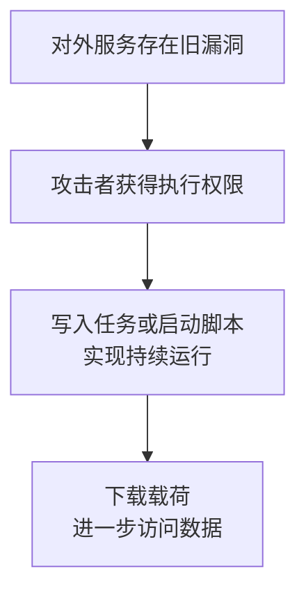

因此，这轮检查也包含了计划任务、启动项和异常账户，逐项查找可能留下的脚本和持续运行的程序。

### PHP 这条线

还有一条是最近受到关注的 **PHP2Shell**。它涉及 PHP 运行环境，因此检查范围包括依赖 PHP 的套件、自建网站，以及容器镜像里的 PHP。群晖为此发布了 **SA-26:14** 公告，并持续更新受影响套件的信息。

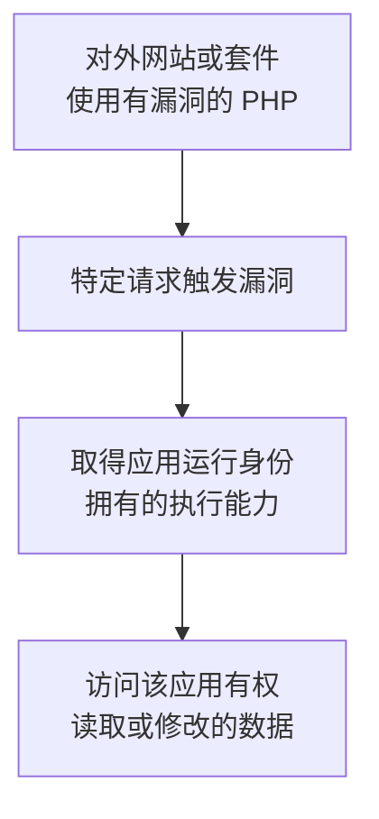

后续披露的 **CVE-2026-115560** 又涉及特定会话序列化切换与上传进度功能的组合条件。因此，处理时既要核对 PHP 版本，也要检查应用实际使用的配置。**更新 DSM、更新套件、更新容器，是三件需要分别确认的事。**

## 2. 更新系统

群晖这次跟进安全修复的速度还是比较快的，已经陆续推出 DSM 和相关套件更新。大家可以先检查自己所在分支的修复要求，再升级到机型支持的最新版本。以 SA-26:13 公告为例，各分支要求更新到以下版本或更高版本：

| DSM 分支 | 已修复版本起点 |
| --- | --- |
| 7.4 | 7.4-90075 |
| 7.3 | 7.3.2-86009-4 |
| 7.2.2 | 7.2.2-72806-9 |
| 7.2.1 | 7.2.1-69057-12 |

打开 **控制面板 → 更新和还原 → DSM 更新**，检查可安装的系统版本，完整核对版本号及后面的 **Update** 编号。

博主这次从 **7.3.1-86003 Update 1**，升级到了 **7.4.1-90080 Update 1**。接着打开“更新设置”，勾选 **自动安装重要更新**，并设置安装时间。这样后续重要安全更新也能及时装上。

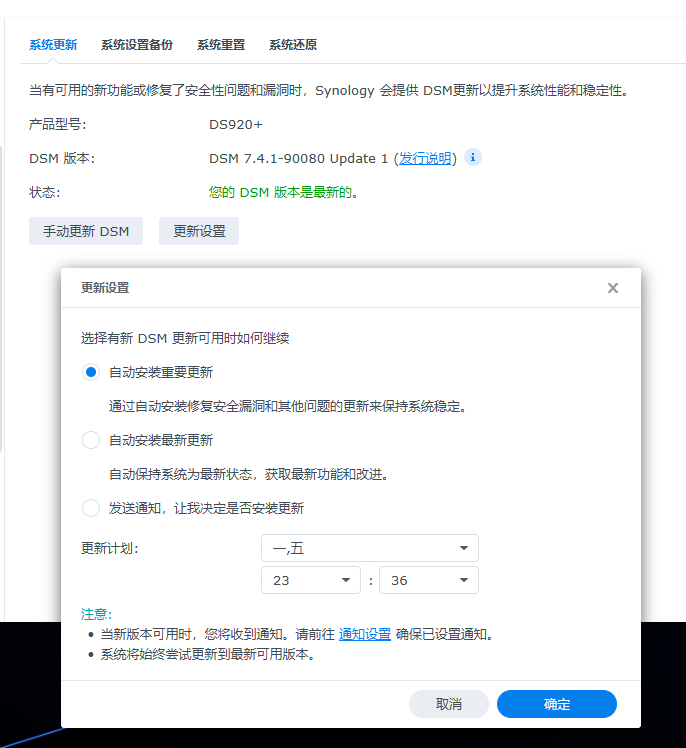

博主之前停留在旧版本，主要也是介意群晖后续版本对视频编解码、转码支持的调整，担心原来依赖的硬解播放方式受到影响，就一直拖着升级。这次还是果断更新了：**比起视频硬解和播放方式的变化，文件安全显然重要得多。**

更新前，可以先导出一份 DSM 配置，确认重要服务的兼容情况，再挑一个有空处理问题的时间操作。更新后重新登录，核对完整版本号，并看看套件中心有没有等待安装的安全更新。

网上也有最新系统仍然中招的反馈。对自己的设备，博主建议先把官方修复及时装上，再依次做好快照、防火墙和远程访问限制。**更新系统，仍然是这轮防护的首要任务。**

## 3. 不可变快照

系统更新是堵入口，快照则是在文件真的出问题时，留下一条恢复数据的路。

### 先理解快照

对于使用 **Btrfs**、支持相应功能的群晖机型，快照可以保留文件在某个时间点的状态。它利用写入时复制机制，在数据发生变化时保留旧的数据块，创建时不需要把整个共享文件夹完整复制一遍。

如果文件后来被勒索程序改写，较早快照里保存的正常版本仍可能用于恢复。**不可变快照**又增加了一段保护期，在这段时间内，快照受到删除保护，减少攻击者拿到高权限后连恢复点一起清掉的机会。

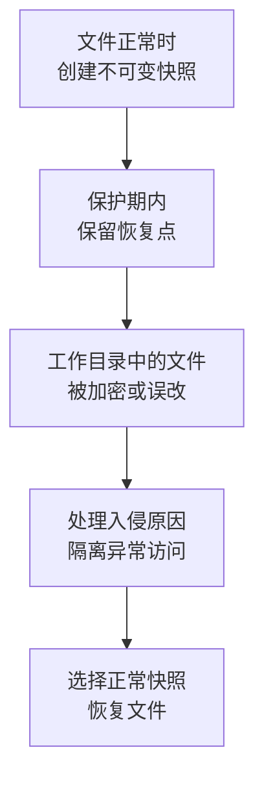

### 安装套件

在套件中心搜索 `replication`，安装 **Snapshot Replication**。相关依赖 **Replication Service** 也需要安装，套件中心一般会提示一起处理。

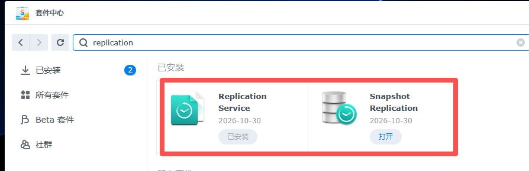

安装后打开 Snapshot Replication，进入左侧的“快照”，选择“共享文件夹”。在这里逐个检查需要保护的目录，选中一个，再点击“设置”。

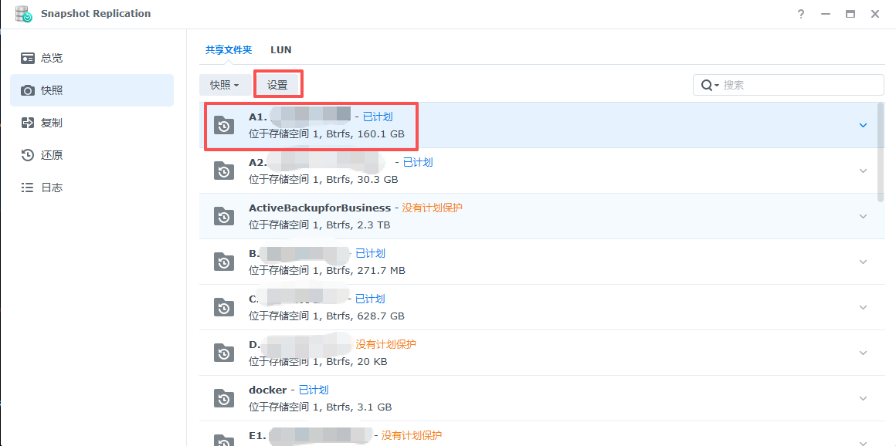

沿着共享文件夹列表，将工作资料、照片、备份和服务数据等需要保护的目录逐个设置好，并记录各自的拍摄频率和保护时间。

### 设置拍摄计划

进入“计划”选项卡，勾选 **启用快照计划**，选择日期、第一次拍摄时间和拍摄间隔，再勾选 **启用不可变快照**，填写保护天数。

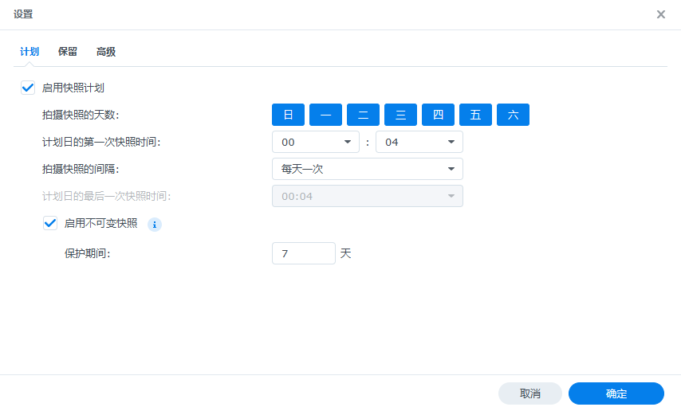

这里有两个数字要一起考虑：**多久拍一次，和每个恢复点锁定多久。**

重要工作资料变化频繁，可以考虑每小时拍一次；变化较少的资料，每天一次也可以。不可变保护期通常可以从 **7—14 天**开始规划，让发现异常和处理问题有一定余量。

博主有些不太重要的目录，安排为每周拍一次、锁定 7 天；经常修改的重要资料，则更适合每天或每小时拍摄。希望每周一次的计划始终留有上一轮受保护的恢复点时，可以把不可变时间延长到 14 天，让相邻两轮之间有一段重叠。

具体可以这样搭配：正在写的文稿、项目文件每小时拍摄，锁定 7—14 天；变化较少的资料每天拍摄，锁定 7—14 天；不太重要的归档按周拍摄，按所需恢复时间设置保护期。快照保留的旧数据块会占用空间，虚拟机、数据库和频繁改写的大文件，可以结合存储余量调整频率。

### 配置保留策略

再进入“保留”选项卡，选择 **Smart Retention 策略**，点击“设置规则”。它的作用，是在短期保留较密的版本，较早的版本逐步按天、周、月保留。

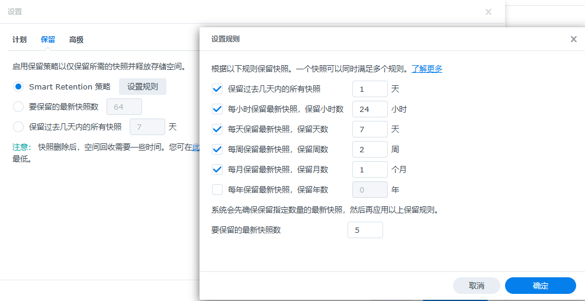

博主这份示例设置为：保留过去 1 天的所有快照、每小时保留最新快照共 24 小时、每天保留最新快照共 7 天、每周保留最新快照共 2 周、每月保留最新快照共 1 个月，并至少保留 5 个最新快照。

**拍摄计划负责创建快照，Smart Retention 负责筛选已有快照。**希望保留每小时的版本，就在计划中设置每小时拍摄；每天拍摄的目录，则按天、周、月整理历史。处于不可变保护期的快照，至少保留到锁定期结束，再按保留策略清理。

### 马上拍第一张

计划保存以后，建议立即选中共享文件夹，点击 **快照 → 拍摄快照**，先创建一个恢复点，再到快照列表核对时间和保护状态。

博主这次也先给共享文件夹补拍了基线快照。从当前状态开始留存版本，后续再交给定时计划自动执行。

最后，挑一个测试文件，熟悉一下浏览历史版本和恢复的入口。快照适合快速找回文件，独立备份则负责应对整机、硬盘或存储空间的问题；重要资料最好两种都留。

## 4. 配置防火墙

接下来，是博主以前忽略最久的一项：防火墙。

打开 **控制面板 → 安全性 → 防火墙**，勾选“启用防火墙”和“启用防火墙通知”。然后新建一个自定义配置文件，进入“编辑规则”。

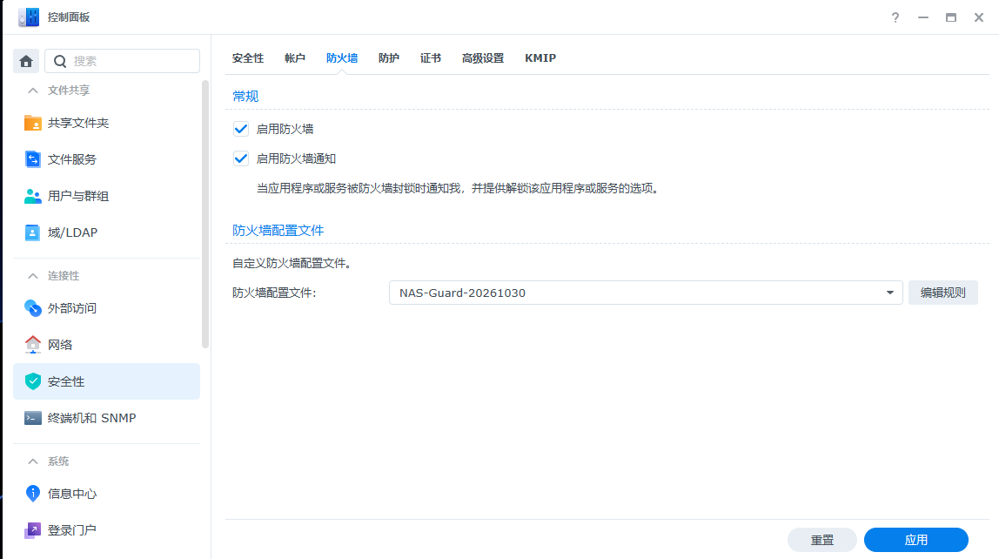

写规则之前，先列一张清单：自己从哪里访问 NAS，需要哪些服务，这些服务分别使用什么端口。博主在这一步就发现，不少以前觉得“开着方便”的入口，其实已经很久没有用过。

### 家庭网络三层

如果 NAS 放在家里，网络结构比较简单，可以按下面的顺序规划：

1. **第一层，家中局域网和虚拟局域网**：按自己的网段放行全部端口、全部协议，供日常管理、同步和备份使用。
2. **第二层，外部网络的必要服务**：开放确实需要公开的端口，并明确使用 TCP 还是 UDP。
3. **第三层，外部网络的其余访问**：全部拒绝。

### 企业/学校网络四层

博主的 NAS 在这种场景下，局域网设备多、来源复杂，自己的设备和其他校内用户需要分开管理。因此，博主实际采用了四层规则：

1. **第一层，信任来源**：自己的虚拟局域网、自建 VPN、常用电脑所在位置，以及 NAS 所在办公室等明确的地址或网段，放行全部端口和协议。
2. **第二层，其他内网来源**：按用途开放 NAS 向整个局域网提供的服务，例如网站、文件共享和内部应用，并拒绝该范围的其余请求。
3. **第三层，公网必要服务**：尽量少开端口。博主只保留对外网站所需的 TCP 80、443，远程组网所需的 UDP 入口按实际配置另行放行。
4. **第四层，全部其余来源**：拒绝所有剩余端口和协议的连接。

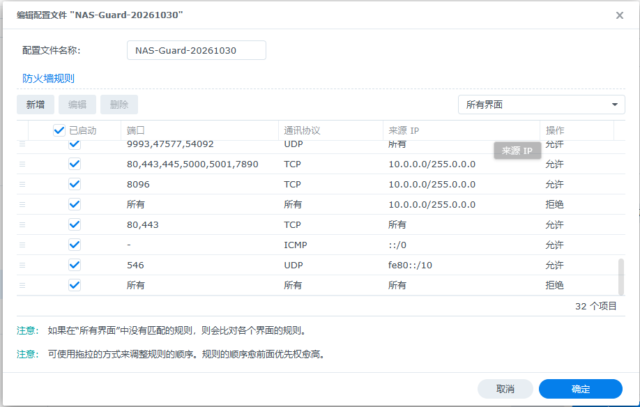

上图可以看到，博主对其他局域网来源使用 `10.0.0.0/8` 范围限制，先允许需要提供的服务，再拒绝这个范围的其余请求；后面是公网网站规则和最终拒绝规则。DSM 从上往下匹配，具体的允许规则排在前面，对应范围的拒绝规则排在后面，最后再放一条全部拒绝。

具体添加时，依次设置“端口”“来源 IP”“操作”。端口尽量选择自定义并写清协议，来源使用单个地址或正确的子网掩码，操作选择允许或拒绝。涉及多块网卡时，还要检查“所有界面”和各接口页面的设置是否符合预期。

### IPv6 也要管

这次最值得提醒的是 **IPv6**。过去博主正是因为有公网 IPv6，配上 DDNS 就能直接访问，非常方便；但这种情况下，NAS 也可能直接接受公网连接，不一定经过我们熟悉的 IPv4 端口转发。

因此，IPv4 和 IPv6 都需要设置访问限制。博主的思路是：公开网站继续允许，DSM 等管理入口仅对信任来源放行；同时保留邻居发现、路径 MTU 等所需的 ICMPv6 通信，使用 DHCPv6 时保留对应的客户端通信。

如果对 IPv6 或整套防火墙规则不太熟悉，可以让 AI 根据实际地址、网络接口和访问需求整理一份规则，再协助写入和验证。后面也会给出一个可直接修改使用的体检提示词。

### 固定组网端口

使用 ZeroTier 的朋友，建议查询对应系统的配置教程，核对并固定实例实际使用的 UDP 端口。除了常见的 9993，实例还可能使用辅助端口。防火墙放行固定后的端口，再重启服务测试连接，可以减少端口变化导致的“设备在线却连不上”。博主这轮也遇到了类似问题，修复后才恢复了虚拟局域网访问。

### 收紧常用端口

**5000/5001、445、22、80/443 等 NAS 常用端口，一定要做好严格的访问限制。**这些常见入口经常成为扫描、爆破和漏洞利用的目标，可以按下面的用途逐个检查：

| 端口 | 常见用途 | 博主建议的访问范围 |
| --- | --- | --- |
| TCP 5000/5001 | DSM HTTP/HTTPS | 自己的内网、VPN 或虚拟局域网 |
| TCP 22，或修改后的端口 | SSH 管理 | 指定管理设备或信任网段 |
| TCP 445 | SMB 文件共享 | 需要共享文件的内网及虚拟局域网 |
| TCP 80/443 | 网站及 HTTPS 服务 | 按网站用途开放，DSM 管理入口单独控制 |
| TCP 5510/6690 | ABB、Drive 数据服务 | 参与备份和同步的私有网络来源 |

**虽然更改 DSM 默认端口对本次漏洞攻击的防范作用很有限，博主还是建议修改一下默认值**，减少常规扫描的干扰。可以在“控制面板 → 登录门户 → DSM”中修改 HTTP/HTTPS 端口，并同步调整自己的书签和客户端地址。SSH 也可以在“终端机和 SNMP”中修改端口，防火墙相应使用实际端口号。

同时，手动关闭不常用的对外连接方式。**博主这次就关闭了 Telnet、FTP 等闲置服务**：在“终端机和 SNMP”中停用 Telnet，在“文件服务”的 FTP 页面停用相关服务；SMB 则禁用老旧的 SMB1，使用 SMB2/SMB3。

应用规则前，先把自己当前的管理地址放进允许范围，保留恢复设置的方法。应用后，分别从可信内网、虚拟局域网和真正的外网测试，核对网站、文件共享、DSM、同步和备份的访问结果。这部分主要处理进入 NAS 的流量，容器端口映射和转发路径也会在后面一并检查。

## 5. 关闭公网 DSM

结合前面的感染过程，博主最想强调的一点是：**一定要避免将 DSM 管理端口直接暴露在公网。**

DSM 登录页一旦能被公网扫描到，攻击者就有机会持续发送恶意请求，寻找漏洞和认证问题。无论使用 DDNS、直接通过公网 IPv4/IPv6 访问，还是经由 Cloudflare 隧道转发，只要公网访客能直接到达 DSM 页面，就存在这个入口的攻击风险。

因此，**应在防火墙中禁止外网访问 DSM 端口，默认就是 5000/5001；修改过端口的，则限制修改后的端口。**仅对自己的内网、VPN 和虚拟局域网来源放行。使用 IPv6 的设备，也一起落实对应限制。

博主最后也做了这个调整：**把所有设备的 Drive、ABB 和管理访问迁入虚拟局域网，关闭公网对 DSM 管理端口的直接访问。**

之前一直没关 5001，主要是几台电脑的客户端都填着“DDNS 域名加端口”。每次想到要重新检查同步和备份配置，就觉得麻烦。但换个角度看，为了省这一次调整，长期把管理入口挂在公网以承受被扫到、被攻击的风险，实在不太划算。

### 日常访问走组网

个人在外网管理 NAS，可以自建 WireGuard VPN，或使用 ZeroTier 虚拟局域网。让电脑、手机和 NAS 接入同一私有网络，之后所有远程管理、文件访问、Drive 自动同步和 ABB 自动备份，都通过这条通道完成。这也是博主更推荐的日常访问方式。

**防火墙中，将 DSM、ABB、Drive 所需端口仅向对应的私有网络来源开放。路由器上原有的 DSM 端口转发、自动映射、DMZ、UPnP，以及旧的对外管理入口，也一起清理掉。**

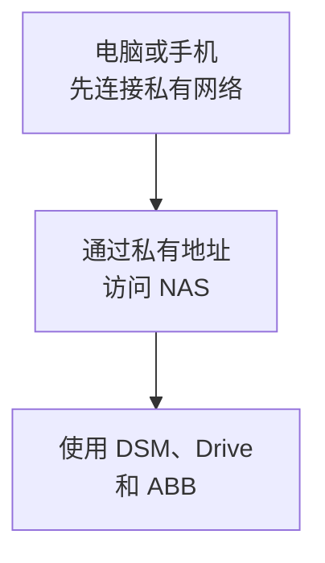

迁移时，建议一次处理一台设备：先确认私有网络可达，再修改客户端连接，检查原有任务、文件夹对应关系和备份目的地，最后实际跑一轮同步或备份，确认任务完成后再继续下一台。

支持直接修改连接地址的客户端，可以保留原任务并更新服务器地址；需要重新建立连接时，先记录已有策略、排除项和文件夹配对，再逐项恢复配置，完成一次实际运行测试。

HTTPS 加密也可以继续保留。对于使用域名证书的服务，可以让原来的证书域名在私有网络中解析到 NAS 的私有地址。这样客户端仍使用域名和有效证书，实际连接走内部通道。再检查证书的自动续期流程，让证书更新与公网管理入口的关闭相互独立。

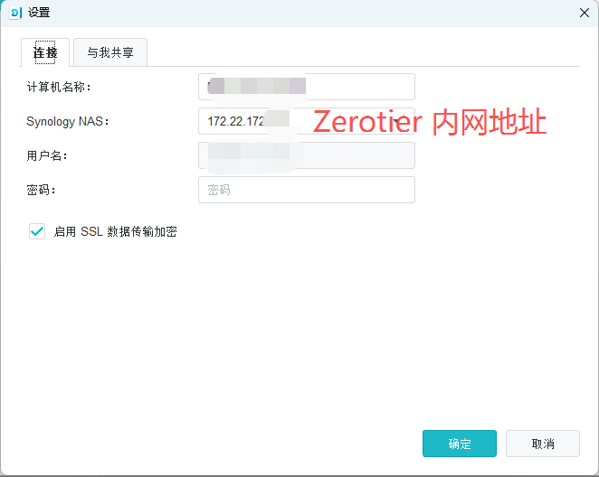

博主目前仍保留公开网站使用的 **80/443**，以便证书续期，DSM、备份同步等私有服务通过组网访问。网站继续公开提供，日常管理和数据传输也能照常进行。

### 必须开放时的方案

如果必须直接对外提供 DSM 的浏览器访问，博主还有一个思路：**继续使用 Cloudflare 隧道，将 NAS 内部的 DSM 端口映射到专用域名的 80/443，再把访问认证和防护规则集中放在 Cloudflare 的域名入口。**

例如，新建一个 `dsm.example.com` 的隧道公开主机名，上游选择 NAS 内网地址的 **5001 端口、HTTPS 协议**。外部浏览器使用域名的 **443** 访问，**80** 统一跳转 HTTPS。

接着为这个主机名配置 **Cloudflare Access**，只允许指定邮箱或身份登录，并开启 MFA。再按自己的使用地区和所用套餐，叠加地区限制、WAF 和请求频率规则。这样访问者先经过 Cloudflare 的身份认证和规则检查，通过后才进入隧道、到达 DSM。

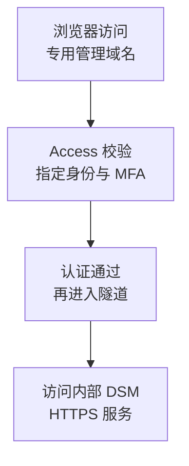

NAS 一侧保留隧道所需的内部访问，公网直接连接源站 DSM 的入口继续关闭。整个方案由域名入口、Access 身份认证、隧道和源站限制共同组成，适合需要从浏览器远程管理的场景。

Drive、ABB 的长期同步和自动备份，博主仍建议统一走私有网络；浏览器管理则可以采用上面的单独入口，分别维护各自的访问策略。

## 6. 其他加固

### 套件与容器

这轮检查里，博主还发现，一个测速 Docker 镜像内的 PHP 存在相关漏洞。原生套件和容器分别有各自的 PHP 环境，因此这次也逐个检查了套件版本、镜像版本和应用实际运行的 PHP。

后来将这个容器中的 PHP 从 **8.5.11 更新到 8.5.12**，核对镜像和实际运行版本后，因为暂时用不到，就把容器停掉了。减少长期运行的服务，本身也能减少需要维护的入口。

PHP 官方针对这轮相关问题发布的修复版本，包括 **8.2.35、8.3.36、8.4.27、8.5.12**。对于后续的 CVE-2026-115560，这次还进一步检查了会话序列化切换与上传进度功能的组合条件。

博主核对了 Web Station 实际使用的 PHP/FPM 配置，将 **`session.upload_progress.enabled` 关闭**，让对应进程重新加载，再确认生效。核验时，以网站服务实际加载的配置和进程状态为准。

容器更新可以按“备份配置和数据 → 拉取新镜像 → 使用新镜像重建容器 → 核对运行版本 → 测试服务”的顺序完成。闲置容器则可以更新后先关闭，需要使用时再启动。

### 转发与目录权限

网络类容器需要额外留意：如果它接受请求后，能够替请求者连接 NAS 本机、回环地址或虚拟局域网，外部访问就可能借它绕到原本受限的管理入口。

这次也针对这类转发路径做了限制：拒绝访问回环地址、NAS 各网络接口地址和虚拟局域网目标，并检查域名解析后的目标地址及不同协议下的处理。让网络服务按预定用途工作，管理端口继续受自己的访问规则控制。

同时，逐个检查容器的挂载目录、特权模式、宿主机网络和管理接口，按应用所需缩小权限范围。涉及 Docker 管理套接字、系统目录和大范围共享目录挂载的服务，优先检查并清理多余授权。

博主也顺手收紧了技术配置目录的权限：管理员保留管理能力，服务只获得运行所需的目录访问，普通账户不再读取包含密码、订阅凭据或密钥的配置。旧网站、旧 PHP、过期脚本和闲置容器，则按依赖关系清理。

### 账号与通知

管理员账户也需要做减法。先确认自己有可正常使用的管理员账号，**再停用系统默认的 `admin`，清退不再使用的管理员成员**，并为保留的管理员开启 **MFA 多重认证**。

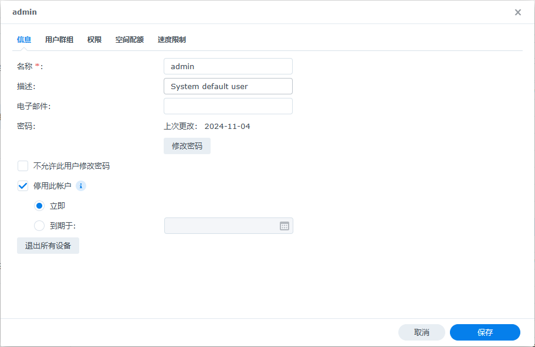

定时任务尽量使用权限受限的服务身份，任务中的密码、DNS 凭据和证书密钥集中放在受限目录中，明确允许读取的用户和服务。

再打开 **控制面板 → 通知设置**，配置电子邮件或推送服务。手机端安装**群晖管家**并完成配对，选择需要接收的事件，最后发送测试消息。

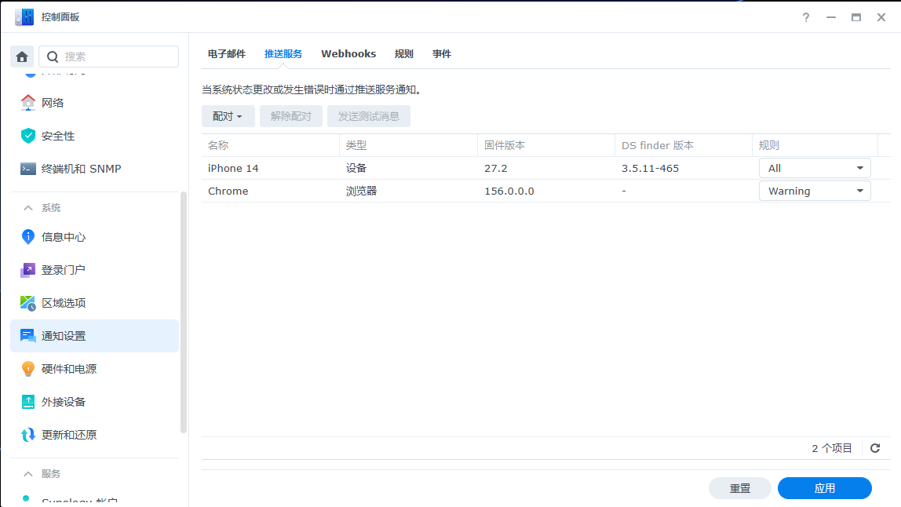

除了登录异常，也可以订阅系统更新、磁盘故障、备份失败和非正常关机等通知。把手机切到移动网络，按平时的 VPN 状态发送一次测试消息，确认离开办公室后也能及时收到 NAS 的异常提醒。

这轮也检查了计划任务、启动项和异常登录记录，未发现与所查勒索样本相符的明显痕迹。相关日志和检查结果一起保留下来，方便后续复查。

## 7. 借助 AI

博主这次还有一个很深的感受：**AI Agent 很适合协助完成这种跨系统、套件、容器和网络的检查。**

如果你在使用 Codex、WorkBuddy，或通过 DeepSeek 等模型搭建的 Harness / Agent 工具，可以让它通过 SSH 连接局域网内的 NAS，直接读取系统、套件、容器和日志信息，整理体检结果，并协助完成修复。把检查范围、证据要求和操作流程写清楚，就能得到一份更具体的清单。

下面这段可以按自己的情况修改后使用：

```text
请帮我检查一台群晖 NAS，重点排查近期 DSM 勒索攻击、
PHP2Shell，以及后续 PHP 会话上传进度相关问题。

设备型号：<NAS_MODEL>
局域网地址：<NAS_IP>
SSH 端口：<SSH_PORT>
管理员账号：<ADMIN_USERNAME>
认证信息由我通过安全输入方式提供，请不要写入报告或输出到日志。

先进行只读检查，并以官方公告、实际版本和配置为依据：
1. 核对 DSM 完整版本、Update 编号、套件和各容器更新情况。
2. 检查 IPv4/IPv6 地址、监听端口、实际公网入口、防火墙顺序，
   以及容器端口映射是否形成其他访问路径。
3. 逐一检查原生 PHP、Web Station 和容器内 PHP，确认实际
   服务使用的配置、上传进度功能和会话处理条件。
4. 检查管理员成员、MFA、默认账号、敏感目录权限、容器挂载、
   特权运行及管理套接字。
5. 检查异常登录、计划任务、启动项、可疑进程和已公开的
   勒索样本特征，说明每项判断对应的证据。
6. 检查各共享文件夹的快照、不可变保护期、保留策略、最近
   成功时间和覆盖空档，并检查独立备份、空间及通知情况。
7. 检查证书续期、远程组网、UPS 和非正常关机记录。

请输出按优先级排列的检查结果，区分已确认问题和待验证项。
不要展示密码、令牌或私钥。修复前说明影响、备份与回滚方式；
删除数据、修改网络入口或中断服务前，先让我确认具体方案。
获准修改后，要验证实际生效状态和原有业务能否正常工作。
```

使用时，可以先让它给出一份完整清单，再按“更新与入口、数据保护、权限与服务”的顺序处理。每做完一项，就让它说明改了什么、如何验证、还剩什么问题，最后汇总成复查报告。

尤其是防火墙，先保住当前管理通道，再逐层收紧；涉及升级和删除，先看清依赖与数据位置。AI 能帮忙把细节翻出来，自己也要借这个过程，逐渐弄明白 NAS 到底是怎么运行的。

## 写在最后

这轮折腾下来，博主最大的变化，是不再把“访问方便”放在所有事情的前面。

系统及时更新，重要目录先有不可变恢复点，管理入口尽量走私有网络，公开服务明确范围，再把账户、容器、权限和通知理顺。每一项单独看都不复杂，难的是以前总觉得“下次再弄”。

如果你也一直没认真检查自己的 NAS，不妨今天就先做三件事：**检查更新，给重要文件夹拍好第一张不可变快照，看看 DSM 登录页是不是仍然谁都能访问。**然后顺着这份清单，把其余保护一点点补齐。

毕竟，我们买 NAS，是为了让数据更安心地保存下来。
